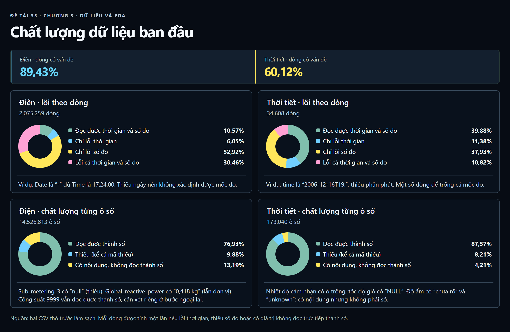
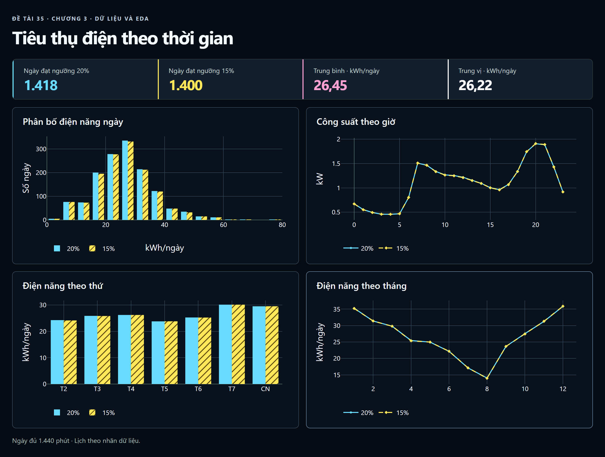
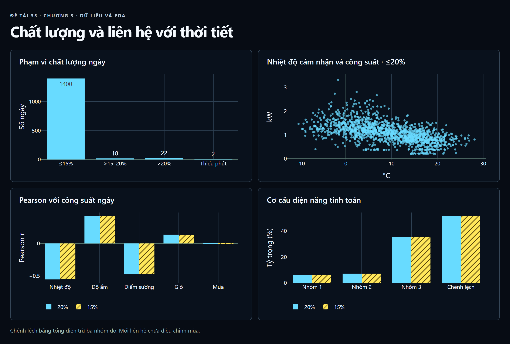
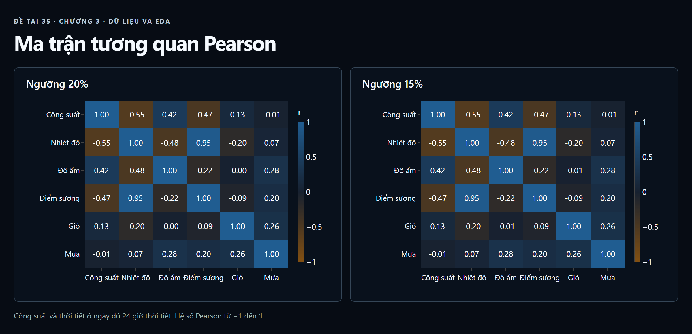
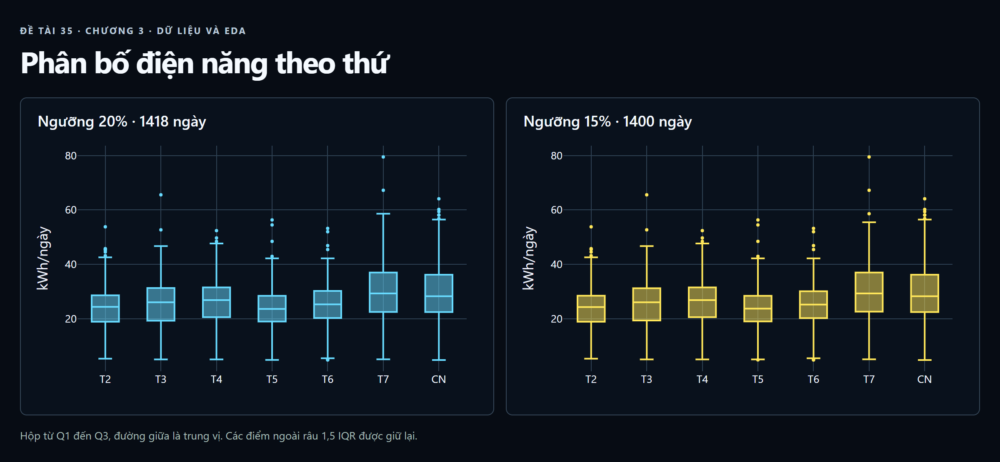
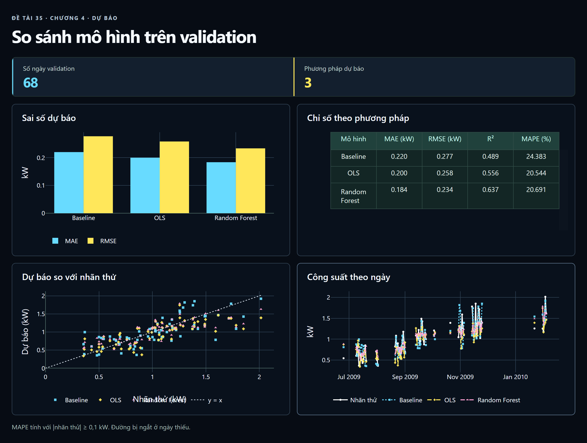
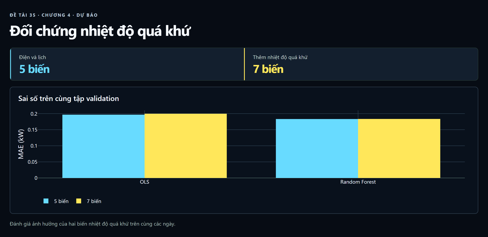
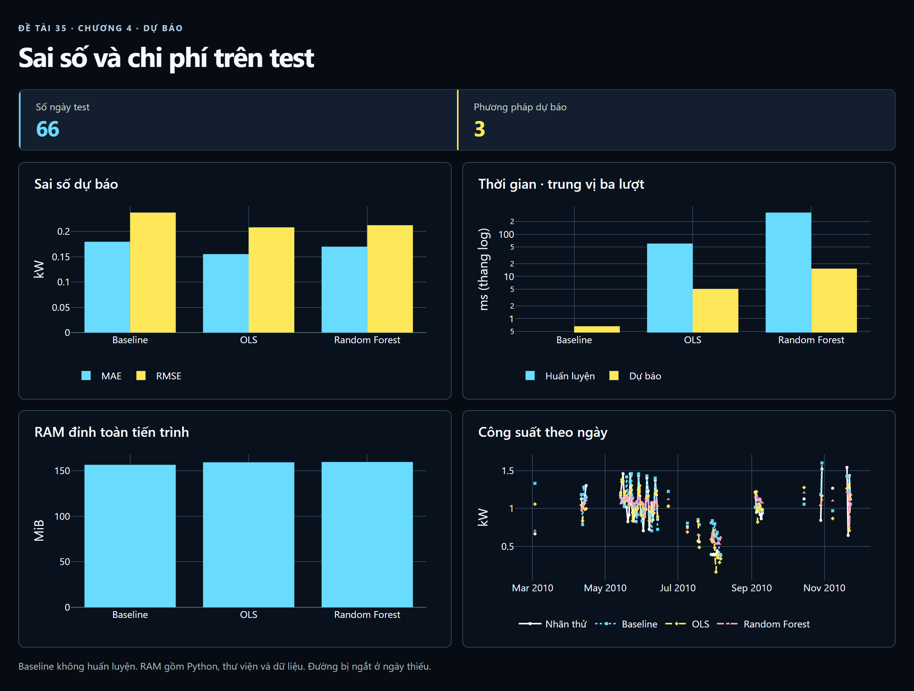
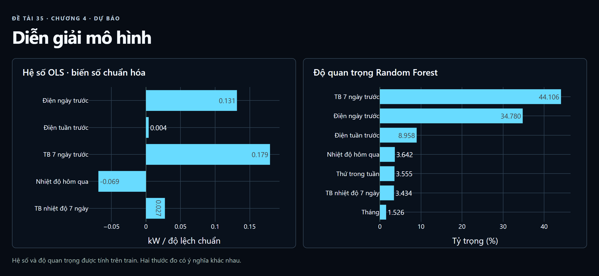

```{=typst}
#set page(flipped: true, numbering: "1")
```

{width=100%}



{width=92%}



{width=92%}



{width=100%}



{width=100%}



{width=100%}



{width=100%}



{width=100%}



{width=100%}
