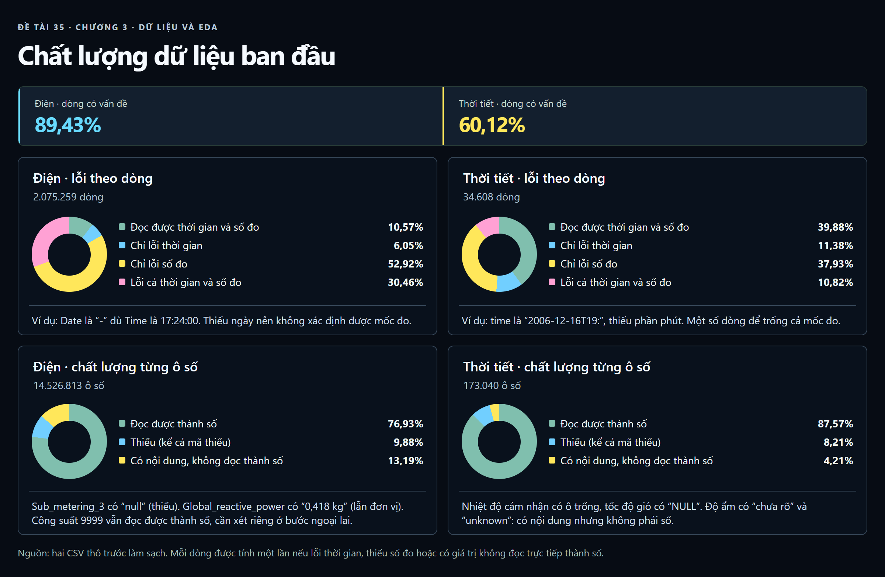
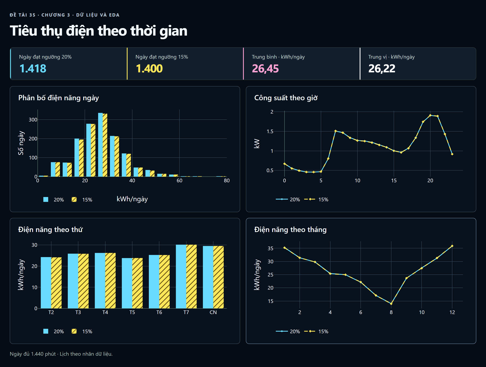
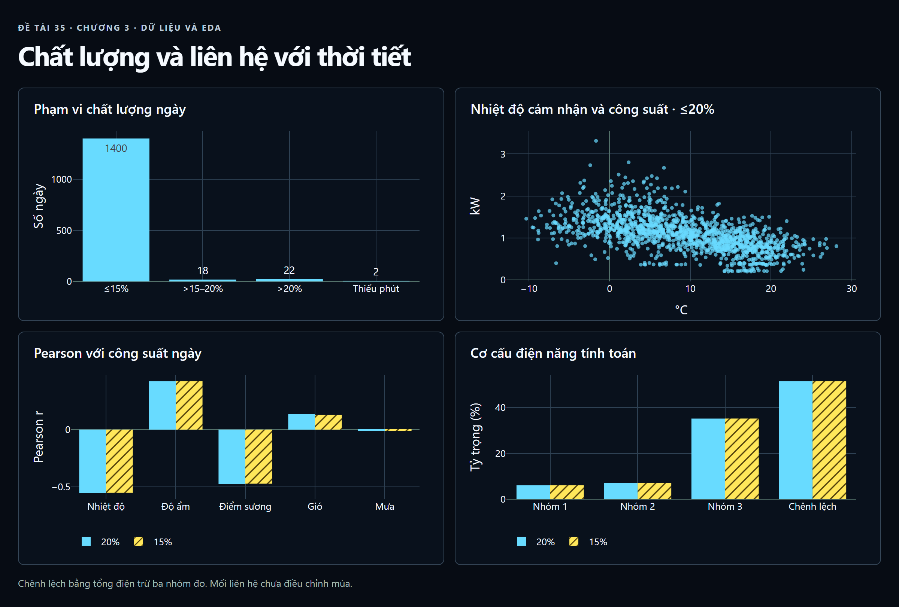
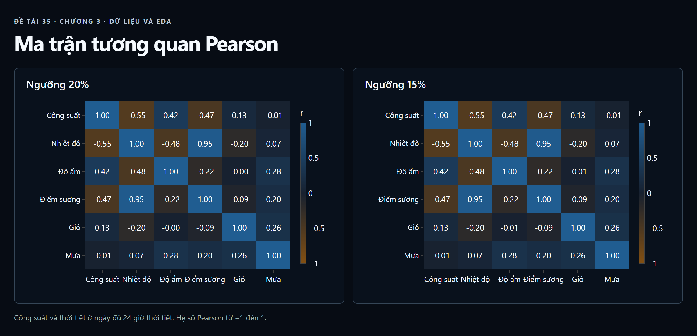
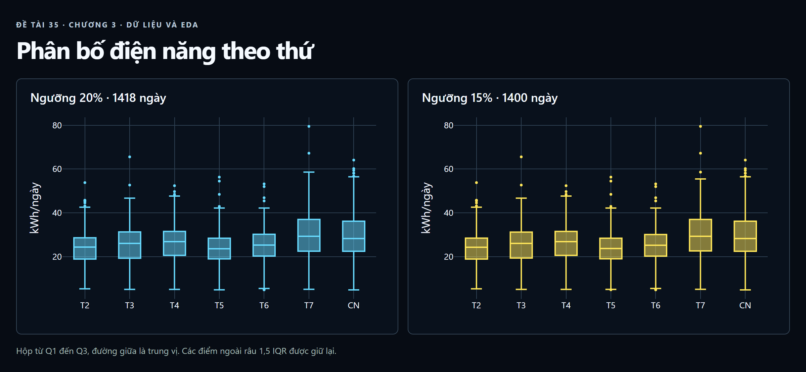
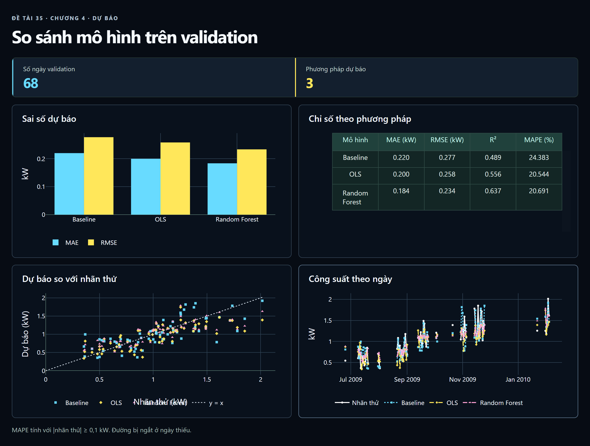
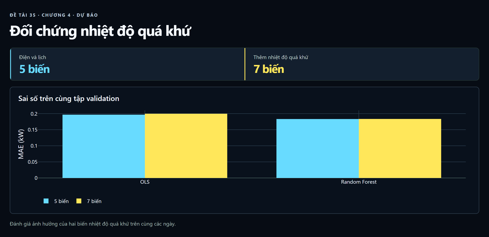
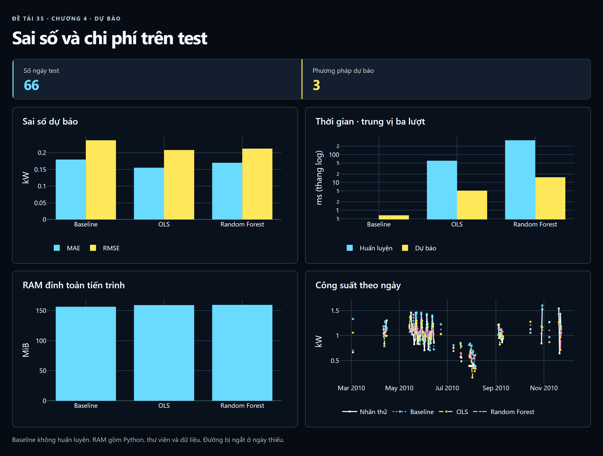
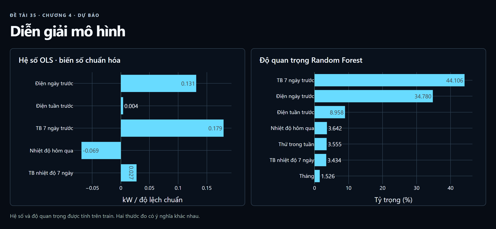

```{=typst}
#set par(spacing: 6pt)
#set figure(numbering: n => "3." + str(n))
#set bibliography(title: [TÀI LIỆU THAM KHẢO])
#let NormalTok(s) = text(fill: black, font: "Times New Roman", s)
#set page(numbering: none)
#block(width: 100%, height: 25cm, stroke: 0.8pt, inset: 14pt)[
  #align(center)[
    #v(0.6cm)
    #text(size: 13pt, weight: "bold")[TRƯỜNG ĐẠI HỌC TÀI CHÍNH - MARKETING]
    #v(0.35cm)
    #strong[KHOA KHOA HỌC DỮ LIỆU]
    #v(0.8cm)
    #image("baocao/assets/logo-truong.png", width: 2.5cm)
    #v(1cm)
    #text(size: 17pt, weight: "bold")[BÀI TIỂU LUẬN KẾT THÚC MÔN HỌC]
    #v(0.55cm)
    #text(size: 13pt, weight: "bold")[LẬP TRÌNH PYTHON CHO KHOA HỌC DỮ LIỆU]
    #v(1cm)
    #text(size: 15pt, weight: "bold")[PHÂN TÍCH TIÊU THỤ ĐIỆN NĂNG HỘ GIA ĐÌNH VÀ DỰ BÁO PHỤ TẢI TIÊU THỤ]
    #v(0.5cm)
    #strong[Đề tài PRJ-35]
    #v(1.1cm)
    #align(left)[
      *Sinh viên thực hiện:*

      Nguyễn Lâm Bình An - MSSV: 2521001033

      Triệu Hoàng Lan Anh - MSSV: 2521001040
    ]
    #v(1fr)
    #text(style: "italic")[Bản trình bày phần đã thực hiện]
    #v(0.3cm)
    #strong[Thành phố Hồ Chí Minh, tháng 11 năm 2026]
    #v(0.3cm)
  ]
]
#pagebreak()
#counter(page).update(1)
#set page(numbering: "i")
#outline(title: [MỤC LỤC], depth: 2)
#pagebreak()
#heading(outlined: false)[DANH MỤC CHỮ VIẾT TẮT]
```

| Chữ viết tắt | Ý nghĩa |
|---|---|
| CSV | Tệp dữ liệu dạng bảng, phân cách các trường bằng ký tự |
| EDA | Phân tích khám phá dữ liệu |
| UCI | Kho dữ liệu học máy của Đại học California, Irvine |
| UTC | Giờ phối hợp quốc tế, mốc tham chiếu khi đối chiếu múi giờ |
| kW | Kilowatt, đơn vị công suất tác dụng |
| Wh | Watt-giờ, đơn vị điện năng |
| NaN | Giá trị thiếu trong dữ liệu số |

**Phạm vi bản trình bày.** Bản này gồm Chương 1 và phần đã thực hiện ở 3.1–3.6 theo khung giảng viên, gồm kiểm định khám phá có điều kiện. Chương 2 chưa viết; Chương 4 đã hoàn thành 4.1–4.6 trên bảng ghép 2.075.259 dòng, gồm chuẩn bị dữ liệu, chia tập, ba phương pháp dự báo, so sánh validation/test, chi phí tính toán và diễn giải mô hình; Chương 5 chưa hoàn thành. Notebook lưu mã và kết quả; báo cáo trình bày phương pháp, phát hiện và giới hạn. Nhật ký dự án nằm trong tệp “nhật ký làm việc.md” tại gốc thư mục, trích từ bản ghi lịch sử có hỗ trợ AI, không coi là chứng nhận tự thực hiện độc lập.

```{=typst}
#pagebreak()
#outline(target: figure.where(kind: "quarto-float-tbl"), title: [DANH MỤC BẢNG BIỂU])
#pagebreak()
#outline(target: figure.where(kind: "quarto-float-fig"), title: [DANH MỤC HÌNH VẼ / BIỂU ĐỒ])
#pagebreak()
#counter(page).update(1)
#set page(numbering: "1")
```

# CHƯƠNG 1: TỔNG QUAN ĐỀ TÀI VÀ MỤC TIÊU NGHIÊN CỨU

## 1.1. Bối cảnh nghiên cứu và lý do chọn đề tài

Đề tài PRJ-35 nghiên cứu mức tiêu thụ điện của một hộ gia đình tại Sceaux, Pháp, kết hợp dữ liệu thời tiết trong giai đoạn tháng 12/2006 đến tháng 11/2010. Dữ liệu điện được ghi nhận theo phút; dữ liệu thời tiết được cung cấp theo giờ. Nguồn điện tham chiếu là bộ Individual Household Electric Power Consumption của UCI; tệp thời tiết có siêu dữ liệu Open-Meteo [@uci; @openmeteo].

Trong bối cảnh ứng dụng quản lý điện năng, phân tích chu kỳ tiêu thụ có thể hỗ trợ nhận diện khung giờ phụ tải cao, tư vấn chuyển thời điểm sử dụng thiết bị và xây dựng phương án dự báo nhu cầu. Đây là bối cảnh ứng dụng của đề tài, không phải bằng chứng rằng dữ liệu được thu thập bởi một phòng ban cụ thể của công ty điện lực.

Ba hướng ứng dụng đã xác định gồm: hỗ trợ điều độ và dự phòng phụ tải; cung cấp căn cứ tham khảo cho biểu giá theo thời gian; và tìm hiểu cơ cấu tiêu thụ theo nhóm thiết bị để tư vấn sử dụng điện. Vì dữ liệu chỉ phản ánh một hộ gia đình, các phát hiện sau này cần được giới hạn trong phạm vi nghiên cứu, chưa đại diện cho toàn bộ khách hàng điện lực.

## 1.2. Xác định vấn đề và câu hỏi nghiên cứu

### 1.2.1. Câu hỏi 1: Chu kỳ tiêu thụ và phụ tải đỉnh

Tiêu thụ điện thay đổi như thế nào theo giờ, ngày trong tuần và tháng/mùa? Những thời điểm nào có mức sử dụng cao hoặc thấp? Mức chênh lệch giữa ngày thường và cuối tuần có ý nghĩa như thế nào?

Câu hỏi được khảo sát bằng thống kê và biểu đồ chu kỳ ở 3.4–3.5. Kiểm định phù hợp với tính phụ thuộc thời gian vẫn chưa thực hiện; các khác biệt hiện chỉ là mô tả.

### 1.2.2. Câu hỏi 2: Cơ cấu thiết bị và liên hệ thời tiết bổ trợ

Điện năng của ba nhóm thiết bị đo đếm chiếm tỷ trọng như thế nào? Các yếu tố thời tiết liên hệ với tiêu thụ ra sao trong phạm vi chất lượng và giả định thời gian của dữ liệu cho phép?

Cơ cấu thiết bị là nội dung chính của câu hỏi. Thời tiết là nhánh bổ trợ có điều kiện, không được coi là quan hệ nhân quả. Kết quả cơ cấu có điều kiện và Pearson đã trình bày ở 3.4; chưa khẳng định nhóm điều nhiệt chi phối thực tế hoặc quan hệ nhiệt độ có dạng chữ U.

### 1.2.3. Câu hỏi 3: Dự báo công suất trung bình ngày kế tiếp

OLS và Random Forest Regressor dự báo công suất tác dụng trung bình ngày kế tiếp tốt hơn phương pháp dự báo bằng cùng ngày tuần trước ở mức nào?

Biến mục tiêu Y là công suất tác dụng trung bình ngày cần dự báo, đơn vị kW. Phát dự báo sau khi kết thúc ngày t cho ngày t+1, chỉ dùng lịch và lịch sử điện đã biết. Điện năng ngày (kWh) được báo kèm để diễn giải. Với ngày đủ 1.440 phút, điện năng bằng tổng công suất phút chia 60, tương đương công suất trung bình ngày nhân 24 giờ. Không cộng các giá trị kW rồi gọi trực tiếp là kWh.

Mô hình chính chưa sử dụng thời tiết quan sát của ngày tương lai. Thời tiết chỉ được cân nhắc khi có căn cứ về thời gian và khả năng sẵn có tại thời điểm phát dự báo. MAE, RMSE, R² và MAPE với điều kiện mẫu số phù hợp là các chỉ số đánh giá dự kiến; chưa huấn luyện hoặc chọn mô hình thắng.

## 1.3. Mục tiêu nghiên cứu

### 1.3.1. Mục tiêu tổng quát

Phân tích chu kỳ và cơ cấu tiêu thụ điện của hộ gia đình, đồng thời đánh giá khả năng dự báo công suất trung bình ngày kế tiếp để hỗ trợ theo dõi và lập kế hoạch sử dụng điện.

### 1.3.2. Mục tiêu cụ thể và tiêu chí hoàn thành

Các đầu ra dưới đây cần hoàn thành trước hoặc trong ngày 30/11/2026, theo thông tin hạn nộp “cuối tháng 11/2026” do sinh viên cung cấp. Giờ đóng cổng nộp chưa được xác nhận.

- Duy trì bảng tổng thể đa nguồn ít nhất 100.000 dòng, có đối chiếu phép ghép và giới hạn thời gian.
- Hoàn thiện hồ sơ làm sạch, chất lượng nhãn dự báo và bằng chứng tối ưu bộ nhớ.
- Xây dựng bảng giờ/ngày đúng đơn vị và rút ra 3–5 phát hiện định lượng.
- So sánh OLS và Random Forest với mốc cùng ngày tuần trước trên cùng tập kiểm tra theo thời gian.
- Đề xuất khuyến nghị dựa trên kết quả và nêu giới hạn áp dụng cho một hộ.

Mốc hoàn thành là ngày 30/11/2026; cần đối chiếu thông báo học phần về giờ nộp cụ thể. Mục tiêu về sai số là đánh giá khả năng cải thiện so với mốc đơn giản; không coi mức R² định trước là kết quả phải đạt.

## 1.4. Đối tượng và phạm vi nghiên cứu

Đối tượng là các đại lượng điện tại hộ gia đình trong giai đoạn 12/2006–11/2010, kết hợp dữ liệu thời tiết đã được cung cấp. Bảng phút giữ vai trò bảng tổng thể; bảng giờ phục vụ EDA và bảng ngày phục vụ dự báo. Đã tạo bảng giờ/ngày ở 3.3.4; chưa tạo nhãn ngày kế tiếp hoặc mô hình.

Phương án đánh giá giữ 20% ngày cuối làm test; 80% ngày đầu dùng phát triển, trong đó đoạn cuối được dùng chọn cấu hình. Các ranh giới ngày được xác định sau khi có bảng ngày đủ điều kiện. Khi đánh giá từng ngày, dữ liệu ngày vừa kết thúc được phép cập nhật vào lịch sử cho lần dự báo tiếp theo; không diễn giải đây là dự báo toàn bộ tập test từ một thời điểm.

Ngày không đủ thời lượng và các giá trị điện được điền cần có cờ chất lượng. Phạm vi nghiên cứu không đại diện mặc nhiên cho mọi hộ gia đình hoặc toàn lưới điện. Giả định múi giờ của phép ghép và nguồn gốc quá trình làm sạch điện được trình bày ở Chương 3.

## 1.5. Ý nghĩa lý luận và thực tiễn

Về học phần, đề tài vận dụng xử lý dữ liệu lớn, ghép bảng, thống kê và hồi quy cho chuỗi thời gian. Về ứng dụng, kết quả có thể cung cấp căn cứ tham khảo về lịch sử dụng thiết bị và dự báo nhu cầu trong phạm vi hộ nghiên cứu.

Các đề xuất về biểu giá hoặc vận hành lưới chỉ được trình bày ở mức khả năng tham khảo. Chưa có dữ liệu để xác định mức giá điện, tiền tiết kiệm hoặc phương án huy động trạm biến áp thực tế.

# CHƯƠNG 3: THU THẬP, GHÉP NỐI VÀ PHÂN TÍCH KHÁM PHÁ DỮ LIỆU

## 3.1. Mô tả nguồn gốc và cấu trúc tập dữ liệu đa tệp

### 3.1.1. Nguồn dữ liệu và đơn vị quan sát

Hai tệp thô được cung cấp cho đề tài là `26_2521001040_Triệu Hoàng Lan Anh_CSV1.csv` và `26_2521001040_Triệu Hoàng Lan Anh_CSV2.csv`. Phần dưới gọi ngắn là CSV1 (điện) và CSV2 (thời tiết). Các tệp thô có chuỗi lỗi và ô thiếu; cần phân biệt chúng với bộ nguồn tham chiếu của UCI và thông tin API của Open-Meteo.

Một dòng CSV1 là một quan sát điện cấp phút tại hộ gia đình; một dòng CSV2 là một mốc thời tiết cấp giờ. Metadata của CSV2 mô tả tọa độ, cao độ và múi giờ. Metadata là thông tin mô tả dữ liệu, không phải một quan sát thời tiết.

| Tiêu chí | CSV1 - Điện | CSV2 - Thời tiết |
|---|---|---|
| Số dòng dữ liệu | 2.075.259 | 34.608 |
| Số cột thô | 9 | 6 |
| Tần suất | Một phút | Một giờ |
| Ký tự phân cách | Chấm phẩy | Phẩy |
| Dòng trước tiêu đề | Không | Hai dòng metadata |
| Nhãn đầu trong file sạch | 16/12/2006 17:24 | 16/12/2006 00:00 |
| Nhãn cuối trong file sạch | 26/11/2010 21:02 | 26/11/2010 23:00 |

: Quy mô và cấu trúc hai bảng dữ liệu {#tbl-quy-mo}

*Nguồn: Nhóm tổng hợp từ hai tệp dữ liệu điện và thời tiết được cung cấp. Khoảng thời gian được xác định theo nhãn thời gian trong các bảng đã xử lý.*

Metadata thời tiết ghi vĩ độ 48,822495; kinh độ 2,2881355; cao độ 46 m; nhãn múi giờ Europe/Berlin, GMT+2 và độ lệch 7.200 giây. Tọa độ này là thông tin vị trí của dữ liệu thời tiết. Chỉ riêng tọa độ chưa chứng minh dữ liệu có nguồn từ một trạm Météo-France cụ thể hoặc đo chính xác vi khí hậu tại hộ gia đình.

### 3.1.2. Từ điển dữ liệu

Các cột thô đang được đọc như chuỗi do chứa lẫn giá trị số, ô thiếu và ký tự lỗi. Bảng dưới mô tả ý nghĩa biến; vai trò cụ thể trong mô hình sẽ được xác định ở bước xây dựng đặc trưng.

| Biến CSV1 | Đơn vị | Ý nghĩa |
|---|---|---|
| Date | Ngày | Phần ngày của mốc quan sát |
| Time | Giờ:phút:giây | Phần giờ của mốc quan sát |
| Global_​active_​power | kW | Công suất tác dụng trung bình phút; dùng tổng hợp mục tiêu trung bình ngày |
| Global_​reactive_​power | kVAR | Công suất phản kháng trung bình phút |
| Voltage | V | Điện áp trung bình phút |
| Global_​intensity | A | Cường độ dòng điện trung bình phút |
| Sub_​metering_​1 | Wh | Điện năng nhóm bếp |
| Sub_​metering_​2 | Wh | Điện năng nhóm giặt ủi |
| Sub_​metering_​3 | Wh | Điện năng nhóm bình nước nóng và điều hòa |

: Từ điển dữ liệu điện {#tbl-dien}

*Nguồn: Nhóm đối chiếu các cột của bảng điện được cung cấp với mô tả thuộc tính của bộ dữ liệu UCI [@uci].*

| Biến CSV2 | Đơn vị | Ý nghĩa |
|---|---|---|
| time | Ngày giờ | Mốc quan sát theo giờ |
| apparent_​temperature | °C | Nhiệt độ cảm nhận |
| RELATIVE_​HUMIDITY_​2M | % | Độ ẩm tương đối ở độ cao 2 m |
| dew_​point_​2m | °C | Nhiệt độ điểm sương |
| wind_​speed_​10m | km/h | Tốc độ gió ở độ cao 10 m |
| precipitation | mm | Lượng mưa trong giờ |

: Từ điển dữ liệu thời tiết; đơn vị được tách khỏi tên cột để dễ đọc {#tbl-thoi-tiet}

*Nguồn: Nhóm tổng hợp từ tên cột và metadata của tệp thời tiết được cung cấp.*

### 3.1.3. Khóa liên kết và cấp dữ liệu phân tích

Hai bảng liên kết theo thời gian. Dữ liệu điện cấp phút được gán thêm khóa giờ để nhiều dòng điện trong một giờ liên kết với một dòng thời tiết của giờ đó. Quan hệ ghép là nhiều-một.

Bảng sau ghép giữ 2.075.259 quan sát điện, đáp ứng yêu cầu ít nhất 100.000 dòng trong đề bài. Các giá trị thời tiết lặp trong cùng giờ không trở thành những quan sát khí tượng độc lập. Bảng giờ/ngày là sản phẩm dẫn xuất riêng ở 3.3.4; không dùng bảng ngày thay minh chứng quy mô sau ghép.

## 3.2. Quy trình ghép nối bảng dữ liệu và tối ưu bộ nhớ

### 3.2.1. Ghép dữ liệu điện và thời tiết

Bảng điện có tần suất phút, còn bảng thời tiết có tần suất giờ. Nhóm tạo khóa hour_key bằng cách đưa thời gian điện về đầu giờ, sau đó ghép trái nhiều-một với thời tiết. Cách này giữ toàn bộ quan sát điện và bổ sung năm biến khí tượng cho mỗi phút, phục vụ phân tích đa nguồn.

Kết quả là bảng tổng thể **2.075.259 dòng, 18 cột**, không có dòng điện thiếu khóa thời tiết và không nhân thêm dòng sau ghép. Bảng này đáp ứng quy mô tối thiểu 100.000 quan sát của đề. Dữ liệu giờ/ngày được tạo riêng phục vụ phân tích, không thay thế minh chứng quy mô cấp phút.

Khóa ghép dựa trên nhãn giờ đang lưu. Metadata thời tiết ghi UTC+2; múi giờ gốc của điện chưa được xác nhận, nên không tự dịch giờ hoặc coi khớp nhãn là đồng bộ thời điểm tuyệt đối. Các phép kiểm tra khóa, số dòng và bảo toàn cột điện được giữ trong notebook; danh sách lỗi và kết quả chi tiết được tính trong notebook.

### 3.2.2. Tối ưu bộ nhớ và lưu trữ

Nhóm áp dụng đọc theo phần, hạ kiểu số, kiểu danh mục và định dạng Parquet. Mỗi cách giải quyết một nhu cầu riêng; không cộng các tỷ lệ tiết kiệm của những phép đo khác nhau.

| Kỹ thuật | Cách áp dụng | Kết quả đo |
|---|---|---|
| Đọc theo phần | CSV điện thô, 100.000 dòng/phần | Phần lớn nhất chiếm 11,49 MiB |
| float32 | 13 cột số của bảng ghép | RAM từ 257,29 xuống 154,37 MiB, giảm 40,00% |
| category | Nhãn thứ và tháng | Giảm gần 75% RAM mỗi cột trong phép đo cấp phút |
| Parquet Snappy | Lưu bảng ghép float32 | 30,35 MiB; chỉ lưu bản Parquet của bảng ghép |

: Các kỹ thuật tối ưu đã áp dụng {#tbl-toi-uu}

*Nguồn: Nhóm đo trực tiếp khi đọc dữ liệu điện, tối ưu kiểu dữ liệu và lưu bảng ghép bằng Parquet theo quy trình mục 3.2.2. Đơn vị: MiB.*

Đọc từng phần cho phép thống kê tệp thô mà không cần giữ toàn bộ tệp cùng lúc [@pandasread]. Category phù hợp với nhãn lặp như thứ/tháng, được dùng trong thống kê chu kỳ; không áp dụng cho số đo liên tục [@pandascategory]. Bước hạ kiểu có kiểm tra sai số, bước ghi Parquet có kiểm tra đọc lại. Mức RAM trong bảng không phải RAM đỉnh của toàn chương trình; các bước ghép vẫn giữ bảng lớn trong bộ nhớ.

Notebook đã chạy thành công toàn bộ 71 cell code trong kernel mới, từ các tệp đầu vào khai báo đến bảng ghép, EDA, mô hình và kiểm tra bổ sung. Đây là kiểm tra khả năng tái lập quy trình với bảng điện sạch bàn giao và hai CSV thô; không phải xác nhận độc lập độ đúng của số đo.

### 3.2.3. Ba bảng dữ liệu chính

| Bảng chính | Vai trò |
|---|---|
| Điện: power_clean_csv1.csv | 2.075.259 dòng phút; số đo điện và cột công suất dành cho dự báo |
| Thời tiết: weather_clean_csv2.csv | Các quan sát theo giờ, nối với điện bằng khóa giờ |
| Ghép: merged_minute_float32_B3.parquet | 2.075.259 dòng; chứa điện, thời tiết và cờ chất lượng |

: Ba bảng chính của quy trình {#tbl-cap-du-lieu}

*Nguồn: Nhóm tổ chức dữ liệu điện, thời tiết và bảng ghép theo quy trình xử lý tại mục 3.1–3.2.*

Ba tệp chính trong data là power_clean_csv1.csv, weather_clean_csv2.csv và merged_minute_float32_B3.parquet. Hai CSV thô được giữ riêng trong data/nguon_goc để tái lập làm sạch. Không lưu thêm bản CSV của bảng ghép. Chương 3 và Chương 4 cùng lấy dữ liệu từ bảng ghép; bảng giờ/ngày, đặc trưng, chia tập và kết quả là các biến DataFrame/Series trong bộ nhớ, không xuất thành tệp trung gian. Các bảng và biểu đồ trong báo cáo được tính từ dữ liệu nêu trên; mã xử lý và kết quả chi tiết có trong notebook đi kèm. Cả 13 cột số, gồm công suất dành cho dự báo, được lưu float32 sau khi kiểm tra sai số; các cột thời gian và cờ chất lượng giữ kiểu tương ứng.

## 3.3. Quy trình làm sạch và xử lý dữ liệu khuyết, ngoại lai

### 3.3.1. Những vấn đề chính của dữ liệu đầu vào

Hai CSV thô có ô thiếu, chuỗi không chuyển được thành số và nhãn thời gian không đọc được. Bảng điện có 757.566 mốc thời gian không đọc được; thời tiết có 7.680 mốc. Các mốc còn đọc được khớp lưới phút/giờ dự kiến. Mốc phải suy ra được theo dõi riêng; không xem việc gán lại lưới thời gian là khôi phục chắc chắn thời điểm đo.

Đếm mỗi dòng một lần nếu mốc thời gian không đọc được hoặc ít nhất một số đo bị thiếu hay không chuyển trực tiếp được thành số. Theo tiêu chí này, bảng điện có **1.855.819/2.075.259 dòng (89,43%)** bị ảnh hưởng, cao hơn bảng thời tiết với **20.806/34.608 dòng (60,12%)**. Đây là mức độ cần xử lý trước phân tích; một chuỗi sai định dạng vẫn có thể khôi phục được giá trị. Phép đếm chưa xét số đo bất thường nhưng đọc được thành số.

Trong bảng điện, trường hợp phổ biến nhất là dòng đọc được thời gian nhưng có lỗi số đo (1.098.253 dòng). Ví dụ, `0,418 kg` xuất hiện ở công suất phản kháng, còn `null` xuất hiện ở nhóm đo thứ ba. Trong bảng thời tiết, độ ẩm có chuỗi `chưa rõ` và một số mốc như `2006-12-16T19:` bị thiếu phút. Bốn nhóm theo dòng trong hình loại trừ nhau; hai vòng phía dưới phân loại từng ô số.

{#fig-chat-luong-tho width=100%}

*Nguồn: Nhóm kiểm tra hai CSV thô ở mục 3.1. Mẫu số theo ô gồm bảy cột số của bảng điện và năm cột số của bảng thời tiết.*

Đối với số liệu điện, file sạch được bàn giao sẵn. Phương án tái lập cho thấy công suất tổng có 287.240 phút cần điền (13,84%); cả 1.442 ngày đều có ít nhất một phút bị đánh dấu, trong đó chín ngày đủ thời lượng bị đánh dấu toàn bộ. Đây là căn cứ chọn phạm vi phân tích, không phải chứng nhận sai số cảm biến.

### 3.3.2. Xử lý bảng thời tiết

Bảng thời tiết được bỏ hai dòng metadata, đổi tên cột và chuyển năm biến khí tượng sang kiểu số. Nhóm giữ mốc thời gian thô đọc được, kiểm tra số dòng và lưới giờ trước khi điền các mốc hỏng; cờ thời gian suy ra và ô thiếu trước điền được lưu riêng.

Bốn biến liên tục được điền từ giá trị hợp lệ gần nhất phía trước bằng ffill [@pandasffill]. Không dùng điểm tương lai để điền ngược. Nhiệt độ cảm nhận ở đầu chuỗi chưa có giá trị trước đó nên giữ thiếu. Mưa thiếu được điền 0 theo giả định; độ ẩm giới hạn 0–100%, gió và mưa không âm.

Kết quả giữ **34.608 dòng**, còn một ô nhiệt độ thiếu trước giờ bắt đầu của bảng điện. Có 1.441/1.442 ngày đủ 24 giá trị ở cả năm biến. Ffill có thể kéo dài một giá trị cũ; mưa điền 0 không phải quan sát xác nhận không mưa. Những giả định này giới hạn cách diễn giải liên hệ thời tiết.

### 3.3.3. Dữ liệu điện và quy tắc chọn ngày phân tích

Nhóm dùng file điện sạch hiện có và xây dựng cờ chất lượng theo phương án tái lập B1. Phương án gồm chuẩn hóa chuỗi số, đánh dấu giá trị ngoài khoảng đang xét và nội suy; kết quả gần khớp file bàn giao nhưng chưa xác nhận mã gốc hoặc tính đúng của các giá trị điền. Chi tiết đối chiếu B1 được giữ trong hồ sơ riêng, không dùng thay bằng chứng nguồn gốc dữ liệu.

Phân tích chính chọn ngày đủ 1.440 phút và tối đa 20% công suất cần điền theo cờ B2, được **1.418 ngày**. Ngưỡng 15% giữ 1.400 ngày, dùng kiểm tra độ nhạy ngắn gọn. Mọi ngày vẫn được lưu; hai ngày biên thiếu thời lượng không được coi là ngày đầy đủ. Hai nhóm lồng nhau, không dùng như hai mẫu độc lập.

Các mức tiêu thụ cao được giữ khi chưa có bằng chứng là lỗi. Ba nhóm đo có 16.173 phút cộng lại vượt tổng điện toàn hộ; không chặn phần chênh lệch âm để ép cân bằng. Vì vậy, cơ cấu nhóm đo được trình bày có điều kiện. Ngưỡng 20% chỉ phục vụ EDA; nguồn nhãn và nội suy điện dùng tương lai vẫn cần xử lý trước đánh giá mô hình.

### 3.3.4. Tổng hợp dữ liệu phục vụ phân tích

Công suất ngày/giờ lấy trung bình các phút. Điện năng kWh bằng tổng công suất phút chia 60; điện năng của các nhóm đo Wh được chia 1.000. Với ngày đủ 1.440 phút, điện năng bằng công suất trung bình nhân 24. Các ngày/giờ thiếu thời lượng giữ giá trị trên phần quan sát, còn đại lượng cả ngày/giờ để thiếu.

Thời tiết lấy từ bảng giờ gốc: trung bình nhiệt độ, độ ẩm, điểm sương, gió; mưa lấy tổng. Không cộng mưa từ bảng phút vì giá trị giờ đã bị lặp. Sau tổng hợp, điện và thời tiết được ghép theo nhãn giờ/ngày, giữ cờ chất lượng để lựa chọn phạm vi EDA. Tổng hợp giờ về ngày đã được kiểm tra khớp; sai lệch số học và bảng kiểm tra chi tiết được giữ trong các biến của notebook.

## 3.4. Thống kê mô tả

### 3.4.1. Công suất và điện năng ngày theo hai ngưỡng chất lượng

Phân tích dùng các ngày đủ 1.440 phút và tối đa 20% công suất cần điền theo cờ B2 (1.418 ngày); nhóm tối đa 15% (1.400 ngày) dùng đối chiếu. Đây là thống kê trên dữ liệu sạch có giá trị được điền, không phải tập phép đo thực đã xác minh. Hai nhóm lồng nhau, không phải hai mẫu độc lập.

| Chỉ tiêu | Công suất 20% (kW) | Điện năng 20% (kWh/ngày) | Điện năng 15% (kWh/ngày) |
|---|---:|---:|---:|
| Số ngày | 1.418 | 1.418 | 1.400 |
| Trung bình | 1,1021 | 26,4512 | 26,4244 |
| Độ lệch chuẩn mẫu | 0,4140 | 9,9356 | 9,9296 |
| Nhỏ nhất | 0,1993 | 4,7839 | 4,7839 |
| Phân vị 25% | 0,8332 | 19,9967 | 20,0060 |
| Trung vị | 1,0925 | 26,2189 | 26,2048 |
| Phân vị 75% | 1,3308 | 31,9397 | 31,9312 |
| Lớn nhất | 3,3121 | 79,4912 | 79,4912 |

: Thống kê ngày theo ngưỡng tỷ lệ công suất cần điền {#tbl-thong-ke-d1}

*Nguồn: Nhóm tính toán từ công suất điện trong bảng ghép, tổng hợp theo ngày và lọc theo hai ngưỡng chất lượng ở mục 3.3. Công suất là trung bình ngày; điện năng ngày đầy đủ bằng công suất trung bình nhân 24.*

Ở nhóm 20%, khoảng 50% số ngày nằm giữa hai phân vị 25% và 75%, tương ứng khoảng 20,00–31,94 kWh/ngày. Khi siết ngưỡng xuống 15%, số ngày giảm 18 và trung bình điện năng giảm khoảng 0,10%; trung vị và độ lệch chuẩn cũng gần nhau. Kết quả cho thấy các thống kê mô tả này ít thay đổi giữa hai ngưỡng đã thử, không chứng minh dữ liệu không sai hoặc kết quả mô hình sẽ tương tự.

### 3.4.2. Các ngày tiêu thụ cao cần xem xét

Ngày có điện năng cao nhất trong nhóm 20% là 23/12/2006, khoảng 79,49 kWh, công suất trung bình 3,3121 kW và tỷ lệ cần điền 13,47%. Hai ngày tiếp theo là 03/02/2007 (67,23 kWh) và 26/12/2006 (65,56 kWh). Cả 10 ngày cao nhất đều đạt ngưỡng 15%; danh sách đầy đủ ở biến top10_d1.

Chưa có bằng chứng cho phép phân loại các mức cao này thành lỗi đo hay đỉnh tiêu thụ thật. Nhóm giữ nguyên các ngày, chưa cắt ngọn hoặc xóa ngoại lệ. Thống kê này không xác định nguyên nhân do thời tiết, mùa hoặc hành vi; cần xem tiếp chu kỳ thời gian và nguồn dữ liệu. Biểu đồ phân bố nằm ở 3.5; kiểm định ngày thường/cuối tuần trình bày riêng tại 3.6.


### 3.4.3. Tiêu thụ theo giờ, thứ và tháng

Dùng các ngày đạt ngưỡng chất lượng 20% và đối chiếu 15%. Bảng giờ lấy toàn bộ 24 giờ đủ thời lượng của mỗi ngày được chọn, không áp ngưỡng 20%/15% riêng cho giờ. Nhóm chính có 34.032 quan sát giờ thuộc 1.418 ngày; nhóm đối chiếu có 33.600 quan sát giờ thuộc 1.400 ngày. Giờ và lịch lấy theo nhãn đang lưu, chưa xác minh múi giờ tuyệt đối.

| Cách nhóm | Nhóm cao nhất | Giá trị ở ngưỡng 20% | Nhóm thấp nhất | Giá trị ở ngưỡng 20% |
|---|---|---:|---|---:|
| Giờ trong ngày | 20 giờ | 1,9068 kW | 4 giờ | 0,4577 kW |
| Thứ trong tuần | Thứ Bảy | 30,1657 kWh/ngày | Thứ Năm | 23,8128 kWh/ngày |
| Tháng trong năm | Tháng 12 | 35,8435 kWh/ngày | Tháng 8 | 14,0377 kWh/ngày |

: Các nhóm cao và thấp theo lịch trong tập ngày được chọn {#tbl-chu-ky-d2}

*Nguồn: Nhóm tổng hợp dữ liệu điện trong bảng ghép theo giờ, thứ và tháng trên các ngày đạt ngưỡng chất lượng. Giá trị là trung bình theo nhóm, không phải đỉnh tức thời hay tổng điện năng tháng.*

Ngưỡng 15% giữ cùng các nhóm cao/thấp. Phần phân tích sau tập trung vào nhóm chính 20%; các bảng trong notebook giữ đầy đủ kết quả kiểm tra độ nhạy.

Các tháng được gộp qua những năm hiện có; số ngày không bằng nhau. Ví dụ nhóm 20% có 108 ngày tháng 12 và 117 ngày tháng 8. Vì vậy, so sánh dùng điện năng trung bình mỗi ngày, không dùng tổng tháng; chưa kiểm soát thay đổi theo năm hoặc cơ cấu ngày. Các bảng lưu số quan sát để người đọc kiểm tra mức bao phủ.

Các kết quả mô tả chu kỳ của hộ đang xét; biểu đồ ở 3.5 giúp quan sát phân bố và mức chênh lệch, chưa thay thế kiểm định.


### 3.4.4. Cơ cấu điện năng các nhóm thiết bị và giới hạn cân bằng

Theo [mô tả bộ dữ liệu UCI](https://archive.ics.uci.edu/dataset/235/individual+household+electric+power+consumption), công suất tổng có đơn vị kW; ba cột Sub_metering là điện năng Wh trên mỗi bản ghi phút. Nhóm 1 gắn với khu bếp, nhóm 2 với khu giặt và thiết bị liên quan, nhóm 3 với máy nước nóng và điều hòa. Đây là các nhóm đo, không phải điện riêng của từng thiết bị.

Quy đổi công suất phút thành kWh bằng chia 60; điện năng của mỗi nhóm chia 1.000. Tổng hợp cùng các ngày đủ thời lượng đạt ngưỡng công suất 20% hoặc 15%. Tỷ trọng bằng tổng điện năng thành phần chia tổng điện năng toàn hộ trên cùng tập ngày, không phải trung bình tỷ lệ của từng phút/ngày. Giữ số thực float64 trong phép tính, từ dữ liệu Parquet float32 đã kiểm tra ở B3.

| Thành phần | Tỷ trọng nhóm ngày 20% | Tỷ trọng nhóm ngày 15% |
|---|---:|---:|
| Nhóm 1 — khu bếp | 6,1082% | 6,1215% |
| Nhóm 2 — khu giặt | 7,1579% | 7,1312% |
| Nhóm 3 — nước nóng và điều hòa | 35,2059% | 35,2244% |
| Chênh lệch tổng trừ ba nhóm | 51,5281% | 51,5229% |

: Tỷ trọng tính từ dữ liệu đã làm sạch {#tbl-co-cau-d3}

*Nguồn: Nhóm tính tỷ trọng điện năng từ công suất tổng và ba nhóm đo trong bảng ghép, trên cùng tập ngày đủ điều kiện ở mục 3.3.*

Nhóm 3 có tỷ trọng lớn nhất trong ba nhóm đo, khoảng 35,21%. Phần còn lại 51,53% là chênh lệch tính toán giữa tổng và ba nhóm, chưa xác nhận là điện thiết bị khác. Do sự không nhất quán theo phút đã nêu ở 3.3.3 và tỷ lệ cần điền của từng nhóm còn cao, kết quả này dùng định hướng kiểm tra thiết bị/dữ liệu, chưa đủ để lượng hóa mức tiết kiệm.

### 3.4.5. Tương quan mô tả giữa công suất và thời tiết

Pearson mô tả chiều và mức độ liên hệ tuyến tính, từ -1 đến 1; dấu âm biểu thị xu hướng ngược chiều. Nhóm tính tương quan giữa công suất trung bình ngày và năm biến thời tiết trên các ngày đủ thời lượng, đạt quy tắc chất lượng [@pandascorr]. Không đưa kWh vào cùng ma trận vì trên ngày đầy đủ nó bằng kW nhân 24.

| Biến thời tiết | r, ngưỡng 20% (1.418 ngày) | r, ngưỡng 15% (1.400 ngày) |
|---|---:|---:|
| Nhiệt độ cảm nhận trung bình | -0,5546 | -0,5526 |
| Độ ẩm trung bình | 0,4221 | 0,4228 |
| Điểm sương trung bình | -0,4749 | -0,4731 |
| Tốc độ gió trung bình | 0,1345 | 0,1278 |
| Tổng mưa ngày | -0,0114 | -0,0124 |

: Pearson giữa công suất trung bình ngày và thời tiết {#tbl-tuong-quan-d4}

*Nguồn: Nhóm tính hệ số Pearson từ công suất và thời tiết tổng hợp theo ngày, trên cùng các ngày đạt ngưỡng chất lượng 20% và 15%.*

Trong nhóm 20%, r khoảng -0,555 ở nhiệt độ cảm nhận cho thấy ngày có nhiệt độ cảm nhận cao hơn thường đi kèm công suất thấp hơn trong tập dữ liệu này. Hệ số không có nghĩa nhiệt độ làm công suất giảm 55,5%. Độ ẩm có liên hệ cùng chiều; gió có hệ số gần 0 hơn, còn mưa gần như không có liên hệ tuyến tính. Không kết luận mưa hoàn toàn không liên quan tới tiêu thụ. Dấu và độ lớn hệ số tương tự ở nhóm 15%.

Tương quan chưa điều chỉnh mùa/xu hướng, không chứng minh nhân quả hoặc năng lực dự báo. Các hạn chế thời gian và điền thiếu ở 3.3 vẫn áp dụng; không dùng thời tiết quan sát tương lai làm đầu vào dự báo.

## 3.5. Trực quan hóa dữ liệu và phát hiện insight kinh doanh

### 3.5.1. Dashboard tiêu thụ theo thời gian

{#fig-dashboard-tieu-thu width=100%}

*Nguồn: Nhóm trực quan hóa kết quả thống kê điện năng và chu kỳ tiêu thụ tại mục 3.4.1–3.4.3. Hình xuất ở 300 DPI.*

Notebook xuất các bảng dùng để vẽ vào thư mục `dashboard_csv/`. Dashboard HTML đọc các bảng này để hiển thị biểu đồ. Dashboard kết hợp chỉ số trung bình/trung vị, phân bố ngày, đường công suất giờ, so sánh thứ và tháng. Màu xanh dương biểu thị ngưỡng 20%, màu vàng biểu thị ngưỡng 15%; dùng cùng đơn vị và thang đo trong mỗi ô. Histogram dùng khoảng chia 5 kWh; số ngày hai nhóm khác nhau được ghi phía trên biểu đồ. Khung 25–30 kWh có nhiều ngày nhất; hai đường chu kỳ gần nhau, cao nhất ở nhãn 20 giờ. Các giá trị cao vẫn giữ nguyên. Tháng được gộp qua nhiều năm nên so sánh trung bình ngày, không dùng tổng tháng hoặc khẳng định quan hệ nhân quả.

### 3.5.2. Dashboard chất lượng và liên hệ bổ trợ

{#fig-dashboard-chat-luong width=100%}

*Nguồn: Nhóm tổng hợp cờ chất lượng của dữ liệu điện, cơ cấu các nhóm đo và tương quan điện–thời tiết tại mục 3.3–3.4. Các nhóm ngày ở ô chất lượng không chồng lặp, tổng bằng 1.442 ngày.*

Dashboard đặt giới hạn dữ liệu cạnh kết quả: 1.400 ngày đủ thời lượng đạt 15%, thêm 18 ngày đạt 20%, 22 ngày đủ thời lượng vượt 20% và hai ngày không đủ thời lượng. Biểu đồ phân tán chỉ gồm 1.418 ngày của nhóm 20%; Pearson đối chiếu cả hai ngưỡng. Cơ cấu thiết bị trình bày bằng cột, ghi rõ chênh lệch chưa được xác minh thay vì coi như một phép đo thiết bị khác. Không chỉnh dữ liệu để làm hình đẹp. Các quan hệ mô tả chưa điều chỉnh mùa, nguồn nhãn hoặc múi giờ.

### 3.5.3. Heatmap tương quan đa biến

{#fig-heatmap width=100%}

*Nguồn: Nhóm tính ma trận Pearson từ công suất và năm biến thời tiết tổng hợp theo ngày, đối chiếu hai ngưỡng chất lượng 20% và 15%. Hình lấy từ dashboard HTML của nhóm.*

Hai ma trận dùng chung thang màu từ -1 đến 1, ghi hệ số trong ô để so sánh cả liên hệ giữa các biến thời tiết. Không dựng ma trận từ bảng năm cặp tương quan với công suất vì bảng đó không chứa tương quan giữa từng cặp thời tiết. Không đưa kWh vào cùng ma trận vì bằng kW nhân 24 trên ngày đủ. Heatmap hỗ trợ nhận diện các biến cùng biến thiên; chưa dùng để chọn biến trên tập kiểm tra hoặc kết luận nhân quả.

### 3.5.4. Phân bố theo thứ và độ phân tán

{#fig-boxplot width=100%}

*Nguồn: Nhóm trực quan hóa điện năng theo thứ từ các ngày đủ 1.440 phút, đối chiếu hai ngưỡng chất lượng 20% và 15%. Hình xuất ở 300 DPI.*

Hộp biểu diễn Q1–Q3, vạch giữa là trung vị; râu kết thúc ở quan sát nằm trong khoảng 1,5 lần IQR tính từ hai cạnh hộp. Các điểm ngoài râu vẫn thuộc dữ liệu phân tích, không tự động là lỗi. Biểu đồ bổ sung độ phân tán cho cột trung bình theo thứ; hai nhóm lồng nhau, chưa có kiểm định để kết luận khác biệt có ý nghĩa.

### 3.5.5. Năm phát hiện và hàm ý kinh doanh

**1. Mức tiêu thụ ngày ít thay đổi giữa hai ngưỡng đã thử.** Nhóm 20% có điện năng trung bình 26,4512 kWh/ngày, trung vị 26,2189 kWh/ngày; khoảng giữa hai phân vị 25% và 75% là 19,9967–31,9397 kWh/ngày. Siết xuống 15% làm trung bình giảm khoảng 0,10%. Sự ổn định có thể do 18 ngày bị loại thêm chiếm tỷ trọng nhỏ; đây là giải thích cần kiểm tra, không chứng minh cách điền đúng. Về quản lý, mức khoảng 26,45 kWh/ngày là mốc tham khảo để theo dõi hộ này, chưa phải định mức chung hay mức tiết kiệm có thể cam kết.

**2. Có khác biệt theo giờ và thứ trong dữ liệu.** Ở nhóm 20%, công suất trung bình cao nhất tại nhãn 20 giờ (1,9068 kW), thấp nhất tại 4 giờ (0,4577 kW). Điện năng ngày trung bình cao nhất ở thứ Bảy (30,1657 kWh), thấp nhất ở thứ Năm (23,8128 kWh). Thứ hạng cực trị giữ nguyên với ngưỡng 15%. Một giả thuyết là hoạt động sinh hoạt tập trung buổi tối và cuối tuần, nhưng dữ liệu không có nhật ký sử dụng thiết bị để xác nhận. Chênh lệch khoảng 1,4490 kW giữa 20 giờ và 4 giờ gợi ý thời điểm cần theo dõi phụ tải và khả năng dịch chuyển thiết bị linh hoạt. Chưa xác minh múi giờ, biểu giá hay mức tiết kiệm tiền.

**3. Trung bình theo tháng có khác biệt rõ về mặt mô tả.** Nhóm 20% có tháng 12 cao nhất (35,8435 kWh/ngày) và tháng 8 thấp nhất (14,0377 kWh/ngày); ngưỡng 15% giữ cùng thứ hạng. Các tháng gộp nhiều năm, số ngày khác nhau và chưa kiểm soát xu hướng theo năm. Mức tháng 12 cao khoảng 2,55 lần tháng 8. Nhu cầu điều nhiệt hoặc thời gian có mặt tại nhà là các giả thuyết giải thích, chưa được kiểm định. Hàm ý là cần dự trù nhu cầu theo mùa và kiểm tra tải điều nhiệt trước giai đoạn cao; chưa suy thành chi phí vì thiếu biểu giá và dữ liệu hành vi.

**4. Cơ cấu nhóm đo còn giới hạn về tính nhất quán.** Nhóm 3 chiếm khoảng 35,21% tổng điện năng trong nhóm ngày 20%, lớn nhất trong ba nhóm đo. Tuy nhiên, toàn chuỗi có 16.173 phút tổng ba nhóm vượt tổng điện toàn hộ, cũng xuất hiện trong CSV float64. Phần chênh lệch 51,53% chưa được coi là điện thiết bị khác đã xác minh. Sai khác có thể liên quan đến quy trình làm sạch riêng các cột, đơn vị hoặc tính nhất quán đo; chưa xác định nguyên nhân. Hàm ý kinh tế trước mắt là ưu tiên kiểm tra dữ liệu nhóm 3 và cân bằng đo trước quyết định đầu tư thay thiết bị, tránh ước tính khoản tiết kiệm từ tỷ trọng chưa tin cậy.

**5. Thời tiết có liên hệ mô tả nhưng chưa chứng minh tác động hoặc năng lực dự báo.** Pearson của công suất với nhiệt độ cảm nhận khoảng -0,555, độ ẩm 0,422 và mưa -0,011 ở nhóm 20%; hệ số gần nhau ở nhóm 15%. Nhu cầu điều nhiệt theo mùa là một giả thuyết, nhưng mùa, dữ liệu đã điền và múi giờ chưa được kiểm soát. Hàm ý là chỉ cân nhắc thu thập dự báo thời tiết có thời điểm phát hành để đánh giá giá trị bổ sung sau này; chưa có bằng chứng đầu tư nhánh thời tiết sẽ cải thiện dự báo hoặc giảm chi phí. Không sử dụng thời tiết quan sát tương lai làm đầu vào.

Các phát hiện trên tổng hợp từ D1–D4, không phải kết quả kiểm định mới. Bài tiếp tục ưu tiên lịch và lịch sử điện cho hướng dự báo đã thống nhất; quyết định mô hình vẫn phải dựa trên dữ liệu hợp lệ theo thời gian và đánh giá ngoài mẫu. Những giới hạn về nguồn nhãn và nội suy dùng tương lai chưa được giải quyết chỉ bằng việc chọn ngưỡng 20%/15%.


## 3.6. Kiểm định giả thuyết thống kê sơ bộ

### 3.6.1. Câu hỏi, giả thuyết và chuẩn bị dữ liệu

Câu hỏi được chọn là: trong cùng một tuần, điện năng trung bình mỗi ngày cuối tuần có khác ngày thường không? Ngày thường gồm thứ Hai–thứ Sáu; cuối tuần gồm thứ Bảy–Chủ nhật. Đây là phân tích khám phá sau khi đã xem EDA, không phải giả thuyết đăng ký trước trên một tập dữ liệu độc lập.

Mỗi tuần bắt đầu thứ Hai tạo một cặp: trung bình của năm ngày thường và trung bình của hai ngày cuối tuần. Chỉ giữ tuần có đủ bảy ngày đạt ngưỡng chất lượng điện 20% đã chọn. Đặt d bằng điện năng trung bình cuối tuần trừ trung bình ngày thường, đơn vị kWh/ngày. Hai giả thuyết dự kiến là H₀: trung bình d bằng 0; H₁: trung bình d khác 0 (hai phía).

| Chỉ tiêu trên các tuần được chọn | Kết quả |
|---|---:|
| Số tuần đủ bảy ngày đạt ngưỡng | 195 |
| Trung bình điện năng ngày thường | 25,2027 kWh/ngày |
| Trung bình điện năng cuối tuần | 29,8524 kWh/ngày |
| Trung bình chênh lệch trong tuần | 4,6497 kWh/ngày |
| Trung vị chênh lệch trong tuần | 4,4205 kWh/ngày |

: Dữ liệu ghép cặp chuẩn bị cho kiểm định {#tbl-chuan-bi-kiem-dinh}

*Nguồn: Nhóm tổng hợp điện năng ngày thường và cuối tuần từ dữ liệu điện trong bảng ghép. Mẫu gồm 195 tuần có đủ bảy ngày hợp lệ, tương ứng 1.365 ngày, theo quy tắc ở mục 3.6.1.*

Kiểm định t ghép cặp xem xét trung bình các chênh lệch của các quan sát tương ứng [@nistpaired]. Ghép trong cùng tuần giúp hạn chế khác biệt thời điểm trong năm giữa hai nhóm, nhưng không tự làm các tuần độc lập. Trước chọn phép kiểm định cần xem xét phụ thuộc thời gian; tương quan giữa các giá trị của cùng một chuỗi ở các thời điểm khác nhau là tự tương quan [@nistautocorr]. Giới hạn do dữ liệu điện đã điền vẫn áp dụng.

### 3.6.2. Kiểm định với sai số chuẩn HAC và diễn giải

**Phương pháp.** Sai số chuẩn đo độ bất định của trung bình ước lượng, khác độ lệch chuẩn mô tả độ phân tán giữa các tuần. HAC (Heteroskedasticity and Autocorrelation Consistent) ước lượng sai số chuẩn khi độ biến động không đồng nhất và có phụ thuộc thời gian. Tương quan chênh lệch cách một tuần là 0,127 và cách ba tuần là 0,166; đây chỉ là mô tả, không chứng minh độc lập hay xác nhận một mô hình phụ thuộc cụ thể. Bài dùng HAC cho suy luận sơ bộ, t-test ghép cặp làm tham khảo.

Giữ lịch liên tục 205 tuần từ 18/12/2006 đến 15/11/2010; 195 tuần được chọn, 10 tuần bị loại. Trung bình chỉ tính trên 195 tuần. Khi tính HAC, đặt sai lệch đóng góp của tuần bị loại bằng 0 để giữ khoảng cách lịch; không điền điện năng hoặc chênh lệch của tuần đó bằng 0. Với tuần được chọn, sai lệch bằng chênh lệch tuần trừ trung bình. Tổng bình phương sai lệch được cộng với hai lần các tổng tích sai lệch cách k tuần, có trọng số Bartlett bằng 1 − k/(L + 1); chia tổng này cho 195² rồi lấy căn để được sai số chuẩn. Cách tính dùng tổng đóng góp trên lịch, không nén 195 tuần thành chuỗi liên tiếp; cấu phần Bartlett được đối chiếu với mã nguồn Statsmodels [@smhac].

Chọn L = 4 tuần làm cấu hình chính, tương ứng xét liên hệ ngắn hạn khoảng một tháng; 8 và 12 tuần dùng kiểm tra độ nhạy, không chọn độ trễ theo p-value nhỏ nhất. Đây là lựa chọn thực hành, chưa tối ưu băng thông hay chứng minh loại hết ảnh hưởng mùa. Dùng xấp xỉ chuẩn lớn mẫu, không hiệu chỉnh mẫu nhỏ: z bằng trung bình chênh lệch chia sai số chuẩn; khoảng tin cậy 95% bằng trung bình cộng/trừ 1,96 sai số chuẩn. SciPy tính xác suất hai phía và phân vị chuẩn [@scipynorm]. Mức ý nghĩa là 5%.

| Cấu hình | Sai số chuẩn | Khoảng tin cậy 95% (kWh/ngày) | p-value hai phía |
|---|---:|---:|---:|
| HAC 4 tuần (chính) | 0,6478 | [3,3800; 5,9193] | 7,09 × 10⁻¹³ |
| HAC 8 tuần | 0,7336 | [3,2119; 6,0874] | 2,32 × 10⁻¹⁰ |
| HAC 12 tuần | 0,7989 | [3,0838; 6,2155] | 5,89 × 10⁻⁹ |

: Kết quả HAC cho chênh lệch cuối tuần trừ ngày thường {#tbl-hac}

*Nguồn: Nhóm tính kiểm định HAC trên chênh lệch điện năng cuối tuần và ngày thường của 195 tuần. Chênh lệch trung bình là 4,6497 kWh/ngày; cấu hình chính có z = 7,1776. Độ nhạy trong bảng là độ trễ HAC.*

**Đọc kết quả.** Theo phép kiểm định HAC và các giả định của nó, p-value nhỏ hơn 0,05 nên bác bỏ H₀ trong phân tích khám phá này: trung bình điện năng cuối tuần cao hơn ngày thường. Chênh lệch ước lượng là 4,6497 kWh/ngày, khoảng tin cậy chính không chứa 0; kết luận cùng chiều ở hai độ trễ bổ sung. P-value không phải xác suất H₀ đúng; mức tin cậy 95% mô tả độ bao phủ của quy trình khoảng khi lặp lấy mẫu dưới các giả định, không phải xác suất của H₀.

T-test ghép cặp bằng SciPy cho t = 8,5536, bậc tự do 194, p = 3,57 × 10⁻¹⁵ và khoảng [3,5776; 5,7218] kWh/ngày [@scipypaired]. Kết quả này chỉ tham khảo vì chưa có cơ sở coi các chênh lệch tuần độc lập. Khoảng HAC 4 tuần rộng hơn phản ánh cách ước lượng độ bất định khác.

**Phạm vi kết luận.** HAC cần chuỗi đóng góp có mức trung bình tương đối ổn định và phụ thuộc suy giảm theo thời gian để xấp xỉ có ý nghĩa; các giả định này chưa được xác nhận đầy đủ. Suy luận chỉ mang tính sơ bộ cho các tuần đạt quy tắc chọn của hộ này, không đại diện mọi hộ hoặc các tuần bị loại. HAC không sửa sai lệch do chọn tuần, dữ liệu điền, nguồn điện chưa xác minh hoặc việc chọn giả thuyết sau EDA. Không diễn giải cuối tuần gây tăng tiêu thụ và không dùng kết quả này để chứng nhận nhãn cho mô hình. Hàm ý thực tiễn là ưu tiên theo dõi lịch sinh hoạt cuối tuần; chưa đủ dữ liệu để tính khoản tiết kiệm hoặc quy chiếu cho toàn lưới.

# CHƯƠNG 4: XÂY DỰNG MÔ HÌNH VÀ ĐÁNH GIÁ HIỆU NĂNG

## 4.1. Chuẩn bị dữ liệu và tạo đặc trưng dự báo

### 4.1.1. Bảng ngày thử và giới hạn nhãn

Dự báo được phát sau khi kết thúc ngày t−1 để ước lượng công suất trung bình ngày t (kW), kèm điện năng bằng công suất trung bình nhân 24 giờ. Nguồn đọc duy nhất ở Chương 4 là bảng ghép 2.075.259 dòng: notebook đọc trực tiếp merged_minute_float32_B3.parquet với các cột datetime, cong_suat_du_bao_kw, can_dien_du_bao, moc_suy_ra và năm cột thời tiết. Bảng ngày và bảng đặc trưng đều là kết quả tổng hợp trung gian từ tệp này, không phải bộ dữ liệu độc lập và không đọc lại tệp thô.

Cột cong_suat_du_bao_kw đã được tạo ở Chương 3 khi chuẩn bị bảng điện trước phép ghép: số đo thô được chuẩn hóa ký tự theo quy tắc của B2, lọc theo ngưỡng thử 0–11 kW rồi điền bằng giá trị trước đó trong cùng ngày. Cột này cùng hai cờ can_dien_du_bao và moc_suy_ra giữ dấu vết xử lý trong bảng chính. Đây là giả định làm sạch kế thừa, chưa phải giới hạn đo đã được xác nhận. Không điền lùi, không nội suy hai phía và không lấy điện ngày sau để điền ngày trước; đầu ngày chưa có giá trị hợp lệ vẫn để thiếu.

Lịch phút được kế thừa từ bảng thời gian đã đối chiếu ở Chương 3; 757.566 mốc thô không đọc được giữ cờ mốc suy ra. Vì thế, dù đã bỏ nội suy điện dùng tương lai, độ đúng của lịch và nguồn đo vẫn chưa được xác nhận độc lập. Bảng này là dữ liệu thử theo giả định, không phải bộ nhãn đo thực đã xác minh.

Chỉ đặt nhãn thử cho ngày có đủ 1.440 dòng phút, đủ 1.440 giá trị sau điền và tối đa 20% phút cần điền trước xử lý. Có 1.250 ngày đạt quy tắc trên lịch 1.442 ngày. Không dùng trung bình của một phần ngày rồi coi là trung bình đủ ngày; 192 ngày còn lại để thiếu nhãn. Phạm vi này khác mẫu EDA vì cách điền và yêu cầu đầu ngày đã thay đổi.

### 4.1.2. Đặc trưng dùng thông tin quá khứ

Mỗi dòng là ngày cần dự báo t. Các đầu vào được chọn gồm bảy biến:

- Công suất ngày t−1: `shift(1)`.
- Công suất ngày t−7: `shift(7)`, đồng thời dùng làm baseline cùng ngày tuần trước.
- Trung bình bảy ngày từ t−7 đến t−1: `shift(1).rolling(7, min_periods=7).mean()`.
- Nhiệt độ cảm nhận ngày t−1: `shift(1)`.
- Trung bình nhiệt độ cảm nhận bảy ngày từ t−7 đến t−1.
- Thứ và tháng của ngày t: thông tin lịch biết trước thời điểm dự báo.

Hai biến nhiệt độ là **thời tiết quá khứ**, không phải thời tiết của ngày cần dự báo. Lý do: tại thời điểm phát dự báo cuối ngày t−1, chỉ có bản ghi thời tiết đã quan sát đến hết ngày t−1. Dùng thời tiết ngày t sẽ là biết trước kết quả nên không được phép. Dữ liệu thời tiết của bài này là quan sát thực, không phải bản tin dự báo, nên phép trễ một ngày và trung bình bảy ngày là một cách đưa thông tin thời tiết quá khứ vào mô hình; không phải lựa chọn duy nhất tránh rò rỉ tương lai.

`rolling(7)` tạo cửa sổ bảy dòng; `min_periods=7` yêu cầu đủ bảy giá trị hợp lệ [@pandasrolling]. Dịch một ngày trước khi tính bảo đảm cửa sổ không chứa nhãn ngày t. Lịch ngày liên tục được giữ nguyên trong lúc tạo đặc trưng; không bỏ ngày thiếu rồi mới dịch, vì sẽ làm sai khoảng cách ngày.

Sau khi tổng hợp, bảng ngày giữ năm cột thời tiết (nhiệt độ cảm nhận, độ ẩm, điểm sương, tốc độ gió, tổng mưa). Mưa được lấy một bản ghi mỗi giờ rồi cộng theo ngày; ngày không đủ 24 giờ để thiếu tổng mưa. Trong bảng này, trong năm cột này chỉ hai biến nhiệt độ được dùng làm đầu vào dự báo, các cột còn lại dùng đối chiếu khi cần. Việc lấy một nhóm cột không thay đổi nguồn dữ liệu là bảng ghép. Có 465 ngày đủ nhãn thử và toàn bộ bảy đầu vào; điều kiện này trùng đúng tập ngày của danh sách năm biến cũ, nên phạm vi đánh giá giữ nguyên. Bảng trong bộ nhớ vẫn giữ cả 1.442 ngày và cờ `du_du_lieu_thu`; việc chọn ngày đánh giá chỉ thực hiện sau khi xác định mốc chia thời gian. Thứ/tháng đang lưu bằng số; cách mã hóa phù hợp cho từng mô hình sẽ được xử lý ở bước tiền xử lý. Các cột chất lượng của ngày t chỉ dùng theo dõi và chọn phạm vi đánh giá sau khi quan sát, không thuộc danh sách đầu vào dự báo.

*Nguồn: Nhóm tổng hợp dữ liệu dự báo từ bảng ghép phút theo quy trình mục 4.1. Nhãn và đặc trưng tuân theo quy tắc chất lượng và thời điểm phát dự báo đã nêu; đây là dữ liệu thử, chưa phải số đo được xác minh độc lập.*

```{=typst}
#set figure(numbering: n => "4." + str(n - 11))
#show figure.where(kind: "quarto-float-fig"): set figure(numbering: n => "4." + str(n - 4))
```

## 4.2. Chuẩn hóa và chia tập

### 4.2.1. Chia dữ liệu theo thứ tự thời gian

Trên lịch liên tục 1.442 ngày, lấy 20% cuối làm test; trong phần 80% đầu, lấy 20% cuối làm validation và phần còn lại làm train. Tỷ lệ toàn lịch xấp xỉ 64%/16%/20%; vị trí cắt lấy phần nguyên. Quy tắc được chốt theo thời gian, không lựa chọn theo kết quả mô hình. Không xáo trộn ngày và không lọc ngày thiếu trước khi đặt ranh giới.

| Tập | Khoảng ngày theo lịch | Ngày lịch | Ngày đủ dữ liệu | Ngày loại |
|---|---|---:|---:|---:|
| Train | 16/12/2006–24/06/2009 | 922 | 331 | 591 |
| Validation | 25/06/2009–10/02/2010 | 231 | 68 | 163 |
| Test | 11/02/2010–26/11/2010 | 289 | 66 | 223 |

: Phạm vi chia tập trước và sau chọn ngày đủ dữ liệu {#tbl-chia-tap}

*Nguồn: Nhóm chia lịch ngày tổng hợp từ bảng ghép theo thứ tự thời gian tại mục 4.2.1. Khoảng ngày là ranh giới lịch trước khi lọc các ngày đủ dữ liệu.*

Train dùng học tham số và phép tiền xử lý; validation dùng lựa chọn cấu hình. Test dành cho đánh giá sau khi chốt cấu hình; kết quả tại 4.4 không dùng để điều chỉnh mô hình. Vì EDA đã xem toàn chuỗi, test này không phải tập chưa từng được quan sát hoàn toàn; giới hạn đó phải được công khai khi diễn giải kết quả.

### 4.2.2. Tách đầu vào và nhãn

Sau khi gắn nhãn tập, chỉ lấy các ngày có cờ đủ dữ liệu thử ở 4.1. X gồm bảy cột: ba biến lịch sử điện, nhiệt độ ngày trước, trung bình nhiệt độ bảy ngày trước, thứ và tháng. y là công suất trung bình ngày cần dự báo, đơn vị kW. Nhãn kWh và các cột chất lượng của ngày đích không đưa vào X.

Các tập có lần lượt 331, 68 và 66 dòng. Đã kiểm tra thứ tự thời gian giữa các tập và tổng số ngày đủ dữ liệu bằng 465. Đây là tập con được chọn theo chất lượng nhãn và lịch sử, không đại diện tất cả các ngày; chỉ 66/289 ngày lịch test đủ quy tắc hiện hành. Kết quả mô hình phải báo kèm tỷ lệ bao phủ này, không chỉ báo sai số trên ngày được chọn.

Thiết kế đánh giá là dự báo trước một ngày, cập nhật lịch sử sau mỗi ngày quan sát. Vì vậy, đặc trưng của ngày validation/test được phép dùng giá trị điện các ngày trước trong cùng giai đoạn nếu đã có tại lúc phát dự báo; không dùng nhãn ngày đích. Đây không phải dự báo cả giai đoạn test từ một thời điểm duy nhất. Cờ đủ dữ liệu của ngày đích chỉ được biết sau quan sát và dùng xác định phạm vi chấm điểm, không phải thông tin sẵn có cho mô hình.

### 4.2.3. Chuẩn hóa và mã hóa đầu vào

Năm biến số (ba biến lịch sử điện và hai biến nhiệt độ quá khứ) được chuẩn hóa bằng StandardScaler theo công thức (x − trung bình train) / độ lệch chuẩn train. Scikit-learn dùng độ lệch chuẩn với ddof = 0; các thông số được học từ 331 ngày train và giữ nguyên khi biến đổi validation/test [@skstandard]. Chuẩn hóa thay đổi thang đo đầu vào, không đổi nhãn kW, không loại ngoại lệ và không bảo đảm tăng độ chính xác. Với OLS có hệ số chặn, việc đổi thang tuyến tính không tự làm tăng năng lực dự báo; mục đích ở đây là thống nhất bước xử lý số.

| Biến | Đơn vị gốc | Trung bình train | Độ lệch chuẩn train |
|---|---|---:|---:|
| Điện trễ 1 ngày | kW | 1,120472 | 0,477354 |
| Điện trễ 7 ngày | kW | 1,164501 | 0,460793 |
| Trung bình điện 7 ngày trước | kW | 1,140524 | 0,378575 |
| Nhiệt độ ngày trước | °C | 8,005728 | 7,103913 |
| Trung bình nhiệt độ 7 ngày trước | °C | 7,629343 | 6,901117 |

: Thông số chuẩn hóa học từ train {#tbl-scaler}

*Nguồn: Nhóm tính trung bình và độ lệch chuẩn từ 331 ngày train bằng StandardScaler. Các thống kê này được giữ nguyên khi biến đổi validation và test; nhãn dự báo giữ đơn vị kW.*

Thứ và tháng là biến phân loại, được OneHotEncoder chuyển thành cột 0–1. Dùng `drop='first'` để bỏ một mức tham chiếu trong mỗi nhóm, hạn chế phụ thuộc tuyến tính chính xác khi hồi quy có hệ số chặn. Train chứa đủ bảy thứ và 12 tháng; thứ Hai (mã 0) và tháng 1 làm tham chiếu. Còn sáu cột thứ và 11 cột tháng, không áp thứ tự lớn/nhỏ tuyến tính cho các nhãn lịch [@skonehot]. Dùng mảng thường (`sparse_output=False`) vì bảng nhỏ, dễ đọc; giữ cơ chế báo lỗi mặc định nếu gặp mức chưa học, không âm thầm đổi thành nhóm tham chiếu.

ColumnTransformer chỉ định năm cột số dùng StandardScaler, hai cột lịch dùng OneHotEncoder. Pipeline hiện chứa bước tiền xử lý này; bước hồi quy sẽ được ghép khi huấn luyện [@skcolumn; @skpipeline]. Gọi `fit_transform` một lần trên X_train; X_val và X_test chỉ gọi `transform`. Nhãn y không tham gia bước này. Không cần imputer ở đây vì đã chọn các hàng đủ đầu vào ở 4.2.2; việc điền điện trong ngày ở 4.1 vẫn là một giả định riêng.

Đầu ra gồm 22 cột: train 331 × 22, validation 68 × 22 và test 66 × 22. Bảng biến đổi dau_vao_423 được giữ trong bộ nhớ kèm ngày và tên tập; các cột này chỉ định danh, không đưa vào mô hình. Đã đối chiếu trung bình/độ lệch chuẩn học được với thống kê train, kiểm tra đầu ra hữu hạn và giữ đúng ngày. Khi triển khai mô hình sẽ ghép tiền xử lý và hồi quy trong cùng Pipeline để tránh xử lý hai lần; không fit lại trên validation/test. RF không bắt buộc chuẩn hóa; với RF, năm cột số được giữ nguyên bằng `passthrough` và hai cột lịch được mã hóa đủ mức, tạo 24 cột.

Phần 4.2 đã hoàn thành trên bộ dữ liệu thử. Huấn luyện và đánh giá được trình bày riêng ở 4.3–4.4; không học tiền xử lý hoặc chọn cấu hình theo test. Các giới hạn về nhãn, lịch suy ra và phạm vi ngày được chọn vẫn áp dụng.

## 4.3. Xây dựng các phương pháp dự báo

Ba phương pháp sử dụng cùng bảy đầu vào gốc và cùng phạm vi ngày hợp lệ ở 4.2. OLS và Random Forest học trên 331 ngày train; baseline không cần huấn luyện. Phần này trình bày cấu hình và tạo dự báo; mọi chỉ số và nhận xét so sánh validation/test đặt tại 4.4.

### 4.3.1. Baseline cùng ngày tuần trước

Dự báo ngày t bằng giá trị cùng thứ tuần trước: $\hat{y}_t=y_{t-7}$, một phương pháp mùa vụ đơn giản [@fppaccuracy]. Lấy trực tiếp cột điện trễ bảy ngày chưa chuẩn hóa để giữ đơn vị kW. Dự báo từng ngày với lịch sử cập nhật; không dự báo toàn bộ validation từ một thời điểm. Đầu ra là dự báo trên cùng 68 ngày dành cho cả ba phương pháp.

### 4.3.2. Hồi quy tuyến tính OLS

OLS dự báo bằng $\hat{y}=b_0+\sum_{j=1}^{p}b_jx_j$, học hệ số bằng cách tối thiểu hóa tổng bình phương sai số train [@skols]. Pipeline gồm ColumnTransformer và LinearRegression có hệ số chặn mặc định. Năm cột số được chuẩn hóa; thứ/tháng mã hóa bỏ một mức tham chiếu, tạo 22 đầu vào. Pipeline nhận X gốc, chỉ fit trên train rồi predict validation, không chuẩn hóa hai lần. Giữ cấu hình đầu tiên, không thêm ràng buộc hệ số dương hoặc cắt dự báo sau khi xem kết quả. Đây là hồi quy dự báo, chưa kiểm định ý nghĩa hệ số.

### 4.3.3. Random Forest

RandomForestRegressor kết hợp dự báo từ nhiều cây hồi quy [@skrf]. Cấu hình đầu tiên được đặt trước khi xem kết quả RF: 200 cây, độ sâu tối đa 5, mỗi lá ít nhất 5 mẫu và random_state = 42. Giới hạn độ sâu/kích thước lá nhằm hạn chế cây quá chi tiết trên tập train nhỏ; chưa coi đây là cấu hình tối ưu, không tìm kiếm tham số theo test. Giữ bootstrap và các tham số còn lại theo mặc định của scikit-learn 1.9.1.

Pipeline RF giữ nguyên năm cột số (`passthrough`), mã hóa đủ bảy thứ và 12 tháng bằng OneHotEncoder, tổng 24 cột. RF không bắt buộc chuẩn hóa và không cần bỏ mức tham chiếu như OLS; cả hai vẫn dùng cùng thông tin đầu vào gốc. Encoder và rừng chỉ fit trên train.

## 4.4. So sánh hiệu năng dự báo

### 4.4.1. Kết quả validation

Ba phương pháp được chấm trên cùng 68 ngày validation. Đặt $e_i=\hat{y}_i-y_i$, $n$ là số ngày và $\bar{y}$ là trung bình nhãn của tập đánh giá.

| Chỉ số | Công thức | Ý nghĩa |
|---|---|---|
| MAE (kW) | $\sum_i |e_i|/n$ | Tiêu chí chính; sai lệch tuyệt đối trung bình |
| RMSE (kW) | $\sqrt{\sum_i e_i^2/n}$ | Nhạy hơn với sai số lớn |
| R² | $1-\sum_i e_i^2/\sum_i(y_i-\bar{y})^2$ | So với mốc dự báo bằng trung bình nhãn; có thể âm |
| MAPE (%) | $100\sum_i |e_i/y_i|/n$ | Sai số tương đối; chỉ tính khi $|y_i|\geq0{,}1$ kW |

MAE/RMSE/MAPE càng nhỏ càng tốt; R² càng lớn càng tốt, không phải tỷ lệ ngày dự báo đúng. RMSE không nhỏ hơn MAE. MAPE không xác định tại 0 và nhạy với mẫu số nhỏ; không đặt ngưỡng 10% làm chuẩn chung. Cả 68 ngày validation và 66 ngày test đều đạt ngưỡng mẫu số [@fppaccuracy; @skr2; @skmape].

| Phương pháp | MAE (kW) | RMSE (kW) | R² | MAPE (%) |
|---|---:|---:|---:|---:|
| Baseline | 0,2202 | 0,2772 | 0,4894 | 24,38 |
| OLS | 0,1999 | 0,2584 | 0,5564 | 20,54 |
| Random Forest | 0,1837 | 0,2336 | 0,6374 | 20,69 |

: So sánh trên cùng 68 ngày validation {#tbl-ba-mo-hinh-val}

*Nguồn: Nhóm tính các chỉ số từ dự báo của ba phương pháp và nhãn thử trên cùng 68 ngày validation, theo mục 4.1–4.4.*

{#fig-dashboard-val width=100%}

*Nguồn: Nhóm trực quan hóa dự báo và các chỉ số của ba phương pháp trên cùng 68 ngày validation. Nhãn thử được xây dựng theo mục 4.1.*

RF có MAE validation thấp nhất trong phiên bản bảy biến. Phiên bản này được sửa sau khi đã xem test của phiên bản trước, nên các kết quả test hiện tại là đánh giá lại trên giai đoạn đã biết, không phải một kiểm tra độc lập mới. Giữ nguyên cấu hình ở 4.3, chỉ fit trên 331 ngày train, không gộp validation hoặc chỉnh tham số theo test. Cấu hình và trạng thái tái sử dụng test được ghi trong biến quy_tac_test_44.

**So sánh chênh lệch MAE.** Lấy sai số tuyệt đối của mô hình thứ nhất trừ mô hình thứ hai; giá trị âm thuận lợi cho mô hình thứ nhất. H₀: trung bình chênh lệch bằng 0. Dùng HAC Bartlett như 3.6, giữ khoảng cách ngày lịch; ngày không được chấm có đóng góp sai lệch bằng 0, không điền sai số bằng 0. Độ trễ chính 7 ngày, đối chiếu 14/28 ngày; không chọn theo p-value. Dùng xấp xỉ chuẩn và hiệu chỉnh Bonferroni cho ba cặp (p nhân 3, tối đa 1), mức 5%.

| So sánh | Chênh MAE (kW) | Khoảng 95% từng cặp | p đã hiệu chỉnh |
|---|---:|---|---:|
| Random Forest − OLS | -0,0162 | [-0,0489; 0,0165] | 0,9947 |
| Random Forest − Baseline | -0,0365 | [-0,0959; 0,0230] | 0,6871 |
| OLS − Baseline | -0,0203 | [-0,0857; 0,0452] | 1,0000 |

*Nguồn: Nhóm tính HAC trên chênh lệch sai số tuyệt đối của ba cặp phương pháp trên validation. Khoảng 95% áp dụng cho từng cặp; quyết định dựa trên p-value đã hiệu chỉnh ba phép so sánh.*

Cả ba cặp chưa đạt mức ý nghĩa 5%; kết luận giữ nguyên ở độ trễ 14/28 ngày. Điều này không chứng minh các mô hình tương đương. Đây là suy luận khám phá trên 68 ngày đã chọn, phụ thuộc giả định ổn định trung bình và phụ thuộc thời gian suy giảm; không khắc phục sai lệch chọn mẫu hoặc việc đã dùng validation để so mô hình. Không gọi đây là kiểm định Diebold–Mariano chuẩn.

{#fig-doi-chung width=100%}

*Nguồn: Nhóm chạy đối chứng OLS và RF với năm biến và bảy biến, giữ cùng tập train, cùng 68 ngày validation và cấu hình mô hình tại mục 4.3.*

Kết quả trung thực khi đưa nhiệt độ quá khứ vào: MAE của OLS tăng nhẹ từ 0,1970 lên 0,1999 kW (+0,0029 kW, khoảng 1,5%); RF gần như không đổi, 0,1833 lên 0,1837 kW. Trên 68 ngày validation, thêm thời tiết quá khứ **không cải thiện** dự báo, nên đây là kết quả âm tính cần báo cáo thay vì che giấu. Nguyên nhân có thể là thông tin thời tiết đã nằm phần lớn trong lịch sử điện (nhiệt độ tương quan −0,55 với công suất ngày, Chương 3), nhưng đây mới là giả thuyết, chưa chứng minh nhiệt độ không cung cấp thông tin bổ sung.

**Độ ổn định theo thời gian.** Bổ sung ba cửa sổ liên tiếp, mỗi cửa sổ 180 ngày lịch trước test; tập học mở rộng và luôn đứng trước cửa sổ chấm. Lọc ngày đủ dữ liệu sau khi đặt mốc, học lại toàn Pipeline trên từng tập học bằng cùng cấu hình, không dùng kết quả để điều chỉnh tham số [@sktimecv].

| Cửa sổ chấm | Ngày học/chấm | MAE baseline | MAE OLS | MAE RF |
|---|---:|---:|---:|---:|
| 2008-08-20–2009-02-15 | 216/60 | 0,3338 | 0,2735 | 0,2410 |
| 2009-02-16–2009-08-14 | 276/71 | 0,2719 | 0,2330 | 0,2056 |
| 2009-08-15–2010-02-10 | 347/52 | 0,2117 | 0,2184 | 0,1853 |

*Nguồn: Nhóm đánh giá ba phương pháp trên ba cửa sổ thời gian trước test, mỗi cửa sổ có 180 ngày lịch. MAE tính bằng kW trên cùng các ngày đủ điều kiện trong mỗi cửa sổ.*

RF có MAE thấp nhất ở cả ba cửa sổ; OLS kém baseline nhẹ ở cửa sổ cuối. Đây là kiểm tra độ ổn định bổ sung trên giai đoạn đã biết, không thay thế test độc lập hoặc kiểm định ý nghĩa; số ngày được chấm khác nhau nên không so độ khó các cửa sổ chỉ bằng MAE.

### 4.4.2. Kết quả test

Tập test từ 11/02/2010 đến 26/11/2010 có 66/289 ngày đủ điều kiện (22,84%). Ba phương pháp dự báo cùng các ngày này, chỉ sử dụng lịch sử có trước ngày cần dự báo.

| Phương pháp | MAE (kW) | RMSE (kW) | R² | MAPE (%) |
|---|---:|---:|---:|---:|
| Baseline | 0,1795 | 0,2372 | 0,4261 | 24,71 |
| OLS | 0,1550 | 0,2080 | 0,5587 | 18,81 |
| Random Forest | 0,1698 | 0,2122 | 0,5407 | 20,70 |

: So sánh trên cùng 66 ngày test {#tbl-ba-mo-hinh-test}

*Nguồn: Nhóm tính các chỉ số từ dự báo của ba phương pháp và nhãn thử trên cùng 66 ngày test. Nhãn được xây dựng theo mục 4.1; đây là lần đánh giá lại trên giai đoạn đã được xem trước đó.*

OLS có sai số test thấp nhất: MAE giảm 13,62% so với baseline, tương đương 3,72 kWh/ngày; RF giảm 5,40%, tương đương 4,08 kWh/ngày. Thứ hạng khác validation; không đổi ứng viên hồi tố hoặc tối ưu lại theo test. Chênh lệch đã được kiểm định trên validation như nêu ở 4.4.1; test chỉ dùng để báo cáo nên không lặp lại kiểm định ở đây.

### 4.4.3. Thời gian và bộ nhớ

Đo ba lượt mỗi phương pháp, mỗi lượt trong tiến trình mới; bảng báo trung vị. Cùng 331 dòng train và 66 dòng test, giữ cấu hình mô hình, giới hạn thư viện tính toán ở một luồng. Thời gian gồm tiền xử lý trong Pipeline, không gồm khởi động, nạp thư viện và truyền dữ liệu. Baseline không huấn luyện. RAM là đỉnh bộ nhớ vật lý của toàn tiến trình Windows đến sau dự báo, gồm Python, thư viện và dữ liệu; không phải bộ nhớ riêng của mô hình.

| Phương pháp | Huấn luyện (ms) | Dự báo 66 ngày (ms) | RAM đỉnh (MiB) |
|---|---:|---:|---:|
| Baseline | — | 0,660 | 156,406 |
| OLS | 60,127 | 5,066 | 159,121 |
| Random Forest | 326,184 | 15,315 | 159,504 |

: Chi phí tính toán, trung vị ba lượt độc lập {#tbl-tai-nguyen}

*Nguồn: Nhóm đo trực tiếp ba lượt độc lập cho mỗi phương pháp; bảng báo trung vị. Môi trường: Windows, Intel Core i5-11400H, RAM 15,78 GiB, Python 3.13.7 và scikit-learn 1.9.1. Phạm vi đo thời gian và RAM được nêu tại mục 4.4.3.*

Trong phép đo này, OLS huấn luyện và dự báo nhanh hơn RF; RAM đỉnh của hai mô hình gần bằng nhau. Kết quả phụ thuộc máy và kích thước lô, không đại diện độ trễ triển khai thực tế.

{#fig-dashboard-test width=100%}

*Nguồn: Nhóm trực quan hóa kết quả dự báo trên 66 ngày test và phép đo thời gian, RAM tại mục 4.4.2–4.4.3.*

Nhãn có giá trị điền và mốc thời gian suy ra; mẫu chỉ gồm một hộ, ít ngày đủ điều kiện và test đã xuất hiện trong EDA trước đây. Vì vậy, kết quả chỉ áp dụng cho nhãn thử này, chưa xác nhận hiệu quả trên số đo thực.

## 4.5. Phân tích độ quan trọng của đặc trưng và diễn giải mô hình

### 4.5.1. Hệ số hồi quy OLS

Năm biến số đã chuẩn hóa bằng thống kê train. Khi một biến tăng một độ lệch chuẩn train và các đầu vào khác giữ nguyên, dự báo thay đổi theo hệ số tương ứng [@skcoefinterpret].

| Đặc trưng | Hệ số (kW) |
|---|---:|
| Điện ngày trước | 0,1315 |
| Điện cùng thứ tuần trước | 0,0039 |
| Trung bình điện bảy ngày trước | 0,1793 |
| Nhiệt độ ngày trước | −0,0687 |
| Trung bình nhiệt độ bảy ngày trước | 0,0274 |

: Hệ số OLS của năm biến số đã chuẩn hóa {#tbl-he-so-ols}

*Nguồn: Nhóm trích hệ số của mô hình OLS được huấn luyện trên 331 ngày train theo cấu hình tại mục 4.3.2.*

Trong ba biến lịch sử điện, trung bình bảy ngày có hệ số lớn nhất, tiếp đến là điện ngày trước; hệ số điện tuần trước nhỏ khi đã xét các biến còn lại. Hai biến nhiệt độ có hệ số nhỏ: nhiệt độ ngày trước là −0,0687 kW và trung bình bảy ngày là +0,0274 kW, trái dấu nhau. Dấu âm gợi ý ngày trước càng nóng thì công suất trung bình có xu hướng thấp hơn khi đã giữ lịch sử điện, nhưng độ lớn nhỏ và hai biến trái dấu nên **chưa thể diễn giải thành tác động của thời tiết**; đây là hệ số có điều kiện, không phải nhân quả. Hệ số thứ Bảy và Chủ nhật lần lượt là 0,3870 và 0,3113 kW so với thứ Hai; tháng 8 là −0,1574 kW so với tháng 1, khi giữ nguyên các đầu vào khác. Hệ số của biến lịch và biến chuẩn hóa có cách đọc khác nhau, không xếp hạng chung bằng độ lớn tuyệt đối.

### 4.5.2. Độ quan trọng trong Random Forest

Dùng mức giảm sai số chia nhánh tích lũy trên train (`feature_importances_`), gộp các cột mã hóa thứ/tháng về đầu vào gốc. Trung bình bảy ngày chiếm 44,11%, điện ngày trước 34,78%, điện tuần trước 8,96%; nhiệt độ ngày trước 3,64%, thứ 3,55%, trung bình nhiệt độ bảy ngày 3,43% và tháng 1,53%.

{#fig-dien-giai width=100%}

*Nguồn: Nhóm trực quan hóa hệ số OLS và độ quan trọng đặc trưng RF từ các mô hình học trên 331 ngày train. Hai ô dùng thước đo khác nhau như mô tả tại mục 4.5.*

RF tập trung 87,84% độ quan trọng vào nhóm lịch sử điện, 7,07% vào hai biến nhiệt độ. Đây là tỷ trọng trong mô hình, không phải phần trăm điện năng hoặc mức giảm sai số test. Thước đo trên train có thể ưu tiên biến nhiều giá trị; các biến tương quan cũng làm việc phân chia mức quan trọng khó diễn giải [@skforestimportance]. Thời tiết có mặt nhưng đóng góp khiêm tốn, khớp với kết quả âm tính ở 4.4.1. Kết quả hỗ trợ ưu tiên chất lượng lịch sử điện khi dự báo; không chứng minh tác động nhân quả, không dùng để sửa mô hình sau khi xem test.

**Đối chiếu ngoài train.** Hoán vị từng đầu vào gốc của RF trên 68 ngày validation, lặp 10 lần với seed 42, đo mức tăng MAE mà không huấn luyện lại [@skpermutation]. Trung bình bảy ngày gây tăng MAE nhiều nhất (0,1011 kW), tiếp đến điện ngày trước (0,0441 kW); thứ trong tuần là 0,0122 kW. Kết quả bổ trợ cho vai trò của lịch sử điện. Độ lệch chuẩn giữa lần hoán vị không phải khoảng tin cậy; xáo trộn phá cấu trúc thời gian và liên hệ giữa biến nên chỉ dùng chẩn đoán mô hình, không suy ra nhân quả hay tự động loại biến. Kết quả chi tiết được trình bày trong phần kiểm tra hoán vị của notebook đi kèm.

## 4.6. Thảo luận kết quả thực nghiệm

### 4.6.1. Độ chính xác và chi phí tính toán

Cả OLS và RF đều giảm MAE, RMSE so với baseline trên hai tập đánh giá. Tuy nhiên, RF dẫn đầu theo MAE validation còn OLS có sai số thấp nhất trên test. Phân tích HAC của chênh lệch sai số tuyệt đối chưa cho thấy khác biệt có ý nghĩa ở mức 5% trên validation sau hiệu chỉnh ba cặp. Kết quả cho thấy mô hình phức tạp hơn chưa chắc tốt hơn trong mọi giai đoạn; quy mô mẫu nhỏ khiến khoảng tin cậy của chênh lệch còn rộng.

OLS có lợi thế về thời gian huấn luyện và dự báo trong phép đo ở 4.4.3; RAM đỉnh hai tiến trình gần tương đương. Vì vậy, OLS là phương án đáng đánh giá tiếp khi cân nhắc đồng thời sai số, tốc độ và khả năng diễn giải. Đây là nhận định sau khi xem test, RF vẫn là ứng viên có MAE validation thấp nhất; bộ test này đã được tái sử dụng sau lần đánh giá trước. Muốn chọn OLS cho ứng dụng cần kiểm tra thêm trên giai đoạn độc lập mới.

### 4.6.2. Ý nghĩa đối với bài toán phụ tải

Kết quả mục 4.5 cho thấy lịch sử điện gần đây giữ vai trò nổi bật trong các mô hình đang xét; hai biến nhiệt độ quá khứ có mức quan trọng nhỏ và chưa cải thiện MAE validation trong cấu hình đã thử. Điều này gợi ý ưu tiên thu thập đều đặn và kiểm tra chất lượng số đo trước khi mở rộng thuật toán, bản tin dự báo thời tiết có thời điểm phát hành phù hợp là một hướng nghiên cứu thêm, chưa được kiểm chứng trong bài. Baseline cùng thứ tuần trước vẫn là mốc đối chiếu đơn giản để xác định mô hình học máy có tạo thêm giá trị dự báo hay không.

Đầu ra hiện tại là công suất trung bình ngày kế tiếp, có thể quy đổi thành điện năng ngày bằng nhân 24. Mô hình chưa dự báo phụ tải từng giờ hoặc đỉnh công suất, nên chưa đủ căn cứ thiết kế biểu giá theo giờ hay điều độ lưới điện. Sai số dự báo thấp hơn cũng không đồng nghĩa hộ gia đình đã tiết kiệm điện.

### 4.6.3. Phạm vi kết luận

Chỉ 66/289 ngày test đủ điều kiện; kết quả chưa mô tả các ngày bị loại. Nhãn có phần điền thiếu, lịch có mốc suy ra, dữ liệu chỉ thuộc một hộ và test từng được xem trong EDA và được đánh giá lại sau khi sửa tập đặc trưng. Vì thế, nghiên cứu mới chứng minh khả năng xây dựng và so sánh quy trình dự báo trên dữ liệu thử, chưa xác nhận hiệu quả vận hành thực tế. Chương 5 sẽ đề xuất cách ứng dụng có điều kiện và các bước kiểm chứng tiếp theo.

# TÀI LIỆU THAM KHẢO {.unnumbered}

::: {#refs}
:::
